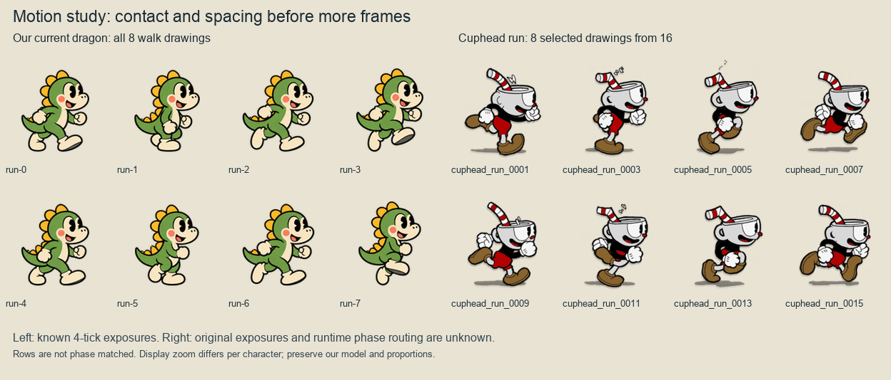

# Character animation study

The biggest gains will come from clearer foot contact and more coherent transitions. We already have enough drawings to improve most locomotion clips. Adding more uniformly timed drawings would leave several confirmed playback problems intact.

This study covers the **current local working tree**, including the preceding enemy animation work. It applies Cuphead motion principles to our existing cast, keeping our designs, line work, proportions, size, movement, collision, firing and knockdown rules. **No production artwork, playback settings or gameplay was changed by this study.**

[Prioritized improvement plan](improvement-plan.md) · [Concrete dragon walk drawing brief](drawing-brief.md) · [Frame and source manifest](reference-manifest.json) · [Engine observations](engine-observations.json)

## Current assessment

- **The added drawings help, especially the wing silhouettes.** Dragon walking now has eight poses, shooting six, and five enemy locomotion clips have eight poses each. The drawings retain recognizable faces and clear outlines. The remaining stiffness is often pose spacing or state selection rather than insufficient image count.
- **Walking lacks a dependable relationship to travel.** In an engine-host probe, 32 movement ticks advanced the same eight poses while travelling 144 logical pixels normally, 201.6 with shoes, or zero against a wall. A stable canvas pivot does not plant the drawn foot in the world. The dragon’s `run-0/4`, `run-1/5` and several imp/boxer pose pairs also have very similar silhouettes; eight different raster files do not necessarily describe eight useful gait stages.
- **Shooting interrupts locomotion visually.** A moving dragon travels 54 logical pixels through the 12-tick shot while standing-looking shot feet replace the walk. Air shooting uses those same grounded drawings. The next picture jumps back to whichever walk/air phase is current, rather than passing through a matching recovery pose.
- **The apex can flicker between emotional poses.** In the inspected jump, `jump-1` appears at tick 22 with `VY=0`, `jump-0` returns at tick 24 with `VY=-3`, and `jump-1` returns at tick 25 with `VY=0`. First downward displacement is tick 29. Landing at tick 51 goes straight to idle. The jump trajectory is intentional; the instantaneous velocity-to-picture mapping is the weakness.
- **Flight has improved extremes but uneven spacing.** Bat `walk-5 → walk-6` jumps from a folded low wing to a high open wing; `6,7,0` cluster around the raised extreme. Bee wings make one slow sweep while the body remains nearly fixed. The hopper’s coils stretch continuously, but their independent 32-tick sine is not tied to actual takeoff or landing.
- **Model registration needs a check across identities.** The blue dragon’s existing second crest/oval accent changes its spacing from the skull, especially at `shoot-0 → shoot-1`. The exporter positions that accent from the whole drawing’s alpha bounds rather than a skull landmark. Preserve the accent’s design and register it to the head. See [all ten identities](11-dragon-identities.png) and [the exporter](/Users/eduardoleale/workspace/tactile-game-engine/the-bubble-brigade/bubble-boobble/tools/cartoon/build-dragon-animation.py:56).
- **Reactions and secondary states are still mostly holds.** Party damage immediately selects `down-0`, bypassing `hurt-0`. Captured enemies have one pose. For every enemy family, the four files named `angry-0`, `warning-0`, `escape-0` and `shoot-0` are pixel-identical. Boss motion has two pictures and its entire existing windup uses one picture.

The numerical observations above come from [the isolated Game Engine probe](engine-probe.test.ts.txt) and its [raw log](engine-probe.log). Coordinates are game-world pixels, not display pixels. These findings characterize the present implementation; their perceptual importance is the study’s assessment.

## What exists and how playback works

The game selects images in TypeScript; it does not ask a generic engine animation player to blend frames. [`clipFrame` and `dragonDraw`](/Users/eduardoleale/workspace/tactile-game-engine/the-bubble-brigade/bubble-boobble/src/cartoon/plan.ts:18) read the JSON order and durations, and [`cartoonSprites`](/Users/eduardoleale/workspace/tactile-game-engine/the-bubble-brigade/bubble-boobble/src/cartoon/renderer.ts:43) lowers each chosen image into a native sprite. Drawing transitions are hard switches.

Simulation runs at **60 ticks per second**. The table describes current playback, not a recommended frame rate. Frame entries and unique drawings are distinguished.

| Animation | Existing drawings and authored timing | Actual selection and transition |
|---|---|---|
| Dragon idle | 2 unique; entries `0,1,0` held `120,7,53` ticks; 180-tick loop | Global game tick, so blinks share phase. Whole sprite width/height pulse by ±1.2%; feet pivot remains fixed. |
| Dragon walk (`run`) | `0…7`, 4 ticks each; 32-tick loop | `WalkFrame` increments with nonzero move input, including wall pressure and time spent shooting/in air. It survives stopping; presentation retains “moving” for a short grace interval. |
| Dragon shoot | `0…5`, 2 ticks each; 12 ticks, nonlooping | `12-Shoot`; wins over walk and air. Bubble and first pose appear together. No prefire delay. |
| Dragon rise/fall | 2; JSON says 18/42 ticks | Those are **not actual timed flight stages**: runtime explicitly samples frame 0 if `VY<0`, frame 1 otherwise. No takeoff, apex or landing clip. |
| Dragon hurt/down | 1 each; JSON nominal holds 12/90 | Solo `Dead>72` selects hurt (18 ticks from 90), then down for the remaining countdown. Party down selects down immediately and holds until rescue. |
| Imp / boxer | 8 each, 4 ticks/pose; 32-tick loop | `Age`; same cadence when angry, with warm tint. Ground walkers still select walking art while airborne. |
| Bat / bee | 8 each; 3 / 2 ticks/pose; 24 / 16 ticks per loop | `Age` in combat, game tick plus offset in preparation. No separate turn/bounce transition. |
| Saucer | 8, 5 ticks/pose; 40-tick loop | Hover-like art over grounded simulation movement. Its existing `Shoot` timer does not currently select a shot picture. |
| Spring hopper | 2 original keys, 16 ticks/key; 32-tick rig cycle | Rigid body and foot strip; only the middle coil strip changes height (12–20 source pixels). Uses `Age`, not ground/air phase. |
| Enemy shot / captive / warning / escape / dead | 1 picture per name | Only boxer shooting gets a dedicated active shot pose (30-tick timer). Escape adds position rocking and periodic flipping; its raster equals warning. |
| Boss | 2 move keys, 8 ticks/key; one attack and one captive picture | Existing 30-tick windup is a held attack picture. Release changes mode back to moving immediately. |

Sources: [clip data](/Users/eduardoleale/workspace/tactile-game-engine/the-bubble-brigade/bubble-boobble/assets/cartoon/animation.json), [player update](/Users/eduardoleale/workspace/tactile-game-engine/the-bubble-brigade/bubble-boobble/src/arcade/player.ts:42), [movement observation](/Users/eduardoleale/workspace/tactile-game-engine/the-bubble-brigade/bubble-boobble/src/cartoon/renderer.ts:25), [jump table](/Users/eduardoleale/workspace/tactile-game-engine/the-bubble-brigade/bubble-boobble/src/arcade/physics.ts:121), [enemy update](/Users/eduardoleale/workspace/tactile-game-engine/the-bubble-brigade/bubble-boobble/src/arcade/enemies.ts:16), [boss states](/Users/eduardoleale/workspace/tactile-game-engine/the-bubble-brigade/bubble-boobble/src/arcade/boss.ts:56). Exact counts and identical-raster groups are in [the inventory](asset-inventory.json).

**Anchors and scale.** Full actor canvases are 128×128. The common logical foot pivot is `[64,120]`, mirrored about the canvas center. The courtyard’s sprite envelopes remain 141.312 game pixels for players and 123.648 for ordinary enemies, before viewport scale. Flight exports align a face/goggle landmark. Hopper slices carry their own canvas dimensions. Atlas trimming preserves the original canvas; it does not create animation or fix contact. Current exports bottom-center each ground drawing’s content, which can hide intended support changes. Future authored motion needs explicit per-pose contact marks, not a new bounding-box fit for every drawing. See [actor layout](/Users/eduardoleale/workspace/tactile-game-engine/the-bubble-brigade/bubble-boobble/src/cartoon/actor-layout.ts:2) and the [dragon](/Users/eduardoleale/workspace/tactile-game-engine/the-bubble-brigade/bubble-boobble/tools/cartoon/build-dragon-animation.py:20) / [enemy](/Users/eduardoleale/workspace/tactile-game-engine/the-bubble-brigade/bubble-boobble/tools/cartoon/build-enemy-animation.py:22) exporters.

## What the references show

**Evidence rule.** I checked 175 drawings across 20 local reference groups (all selected files are listed and hashed in the manifest), sorted numeric suffixes explicitly, and inspected every selected drawing in the sheets. That verifies exported drawings and a plausible visual progression. It does **not** establish original runtime frame order, frame exposure, animation speed, loop endpoints, pivots or transition triggers. No timing/pivot metadata for these selected clips was found. All timing in the improvement plan and drawing brief is a proposal for our game.

### Running and foot contact

[Full comparison sheet](02-run-comparison.png). Cuphead’s [run 0001](/Users/eduardoleale/workspace/art/cuphead/extracted/playable-characters/108720-cuphead/Cuphead/Cuphead/cuphead_run_0001.png), [0005](/Users/eduardoleale/workspace/art/cuphead/extracted/playable-characters/108720-cuphead/Cuphead/Cuphead/cuphead_run_0005.png) and [0006](/Users/eduardoleale/workspace/art/cuphead/extracted/playable-characters/108720-cuphead/Cuphead/Cuphead/cuphead_run_0006.png) show distinct support, toe-off and airborne shapes. Across 0001–0016 the boots roll, the leg folds through a swing arc, the arm silhouettes exchange, and the head/straw follow the body’s rise and fall. The drawn floor shadow makes height differences visible. Deadly Daisy’s run separately makes long support, passing and flight silhouettes easy to distinguish.

Our dragon has recognizable stride pictures but weaker distinction between the two steps. First name the support leg in each of eight keys, then draw the heel/sole/toe progression and a small pelvis arc. Preserve the short legs and large head; do not borrow Cuphead’s limb lengths, body lean, shadow, costume or silhouette. Loop closure must be judged from `7 → 0` in addition to adjacent drawings.

### Idle and reactions

[Comparison sheet](03-idle-reaction.png). In [Cuphead idle 0001–0005](/Users/eduardoleale/workspace/art/cuphead/extracted/playable-characters/108720-cuphead/Cuphead/Cuphead/cuphead_idle_0001.png), the hands, torso and knees change relation while the standing composition remains grounded. This is articulated weight, not simply a rubber scale of the entire picture. In [hit 0001–0006](/Users/eduardoleale/workspace/art/cuphead/extracted/playable-characters/108720-cuphead/Cuphead/Cuphead/cuphead_hit_0001.png), the arms progress from bent/down to raised and back toward the face; the airborne legs keep the hit silhouette readable.

Our blink is useful and should keep its long rests. If idle needs more life, a small chest lift and delayed tail settle would add more than six evenly exposed whole-body bobs. For damage, one immediate impact and one settling drawing can bridge to our existing prone pose while keeping knockdown and rescue effective immediately. No reference hit timing is implied.

### Jumping, falling and landing

[Air/fall sheet](04-air-and-fall.png) · [Takeoff/landing sheet](05-landing-study.png). Cuphead’s jump pictures [0001–0008](/Users/eduardoleale/workspace/art/cuphead/extracted/playable-characters/108720-cuphead/Cuphead/Cuphead/cuphead_jump_0001.png) roll the curled body; they are not eight labelled rise/apex/fall stages. That somersault would change our dragon’s established performance unnecessarily.

Deadly Daisy is the clearer weight study: [Jump A 0001–0004](</Users/eduardoleale/workspace/art/cuphead/extracted/enemies/181706-forest-follies-enemies/Cuphead/Forest Follies Enemies/Deadly Daisy/Jump A/flowergrunt_jump_A_0004.png>) compresses before [0007–0008](</Users/eduardoleale/workspace/art/cuphead/extracted/enemies/181706-forest-follies-enemies/Cuphead/Forest Follies Enemies/Deadly Daisy/Jump A/flowergrunt_jump_A_0008.png>) releases the legs. Jump B has clusters of near-similar drawings and larger pose changes later: that establishes spacing differences, **not the duration of a hold**. In [Land 0004–0008](</Users/eduardoleale/workspace/art/cuphead/extracted/enemies/181706-forest-follies-enemies/Cuphead/Forest Follies Enemies/Deadly Daisy/Land/flowergrunt_land_0007.png>), contact leads into compression; [0009–0011](</Users/eduardoleale/workspace/art/cuphead/extracted/enemies/181706-forest-follies-enemies/Cuphead/Forest Follies Enemies/Deadly Daisy/Land/flowergrunt_land_0011.png>) recovers toward upright. The A → B → Land interpretation fits the pictures and folders; original state routing remains unverified.

Apply this as a small knee/hip yield and delayed tail recovery in our model. Start by fixing phase selection: a zero-displacement hold must not announce falling. Add a brief contact/recovery pose only after that. A jump drawing must never postpone the actual jump, alter its trajectory or immobilize the player on landing.

The acorn provides a useful indexing check: `Drop/acorn_drop_0001…0003` is followed by `Fall/acorn_drop_0004…0017`. The second folder starting at 0004 is **not evidence of lost art**. The fall pictures rotate the same volume; they do not establish gravitational acceleration or exposure timing.

### Attacking through movement

[Comparison sheet](06-shoot-and-transitions.png). Cuphead has three [straight-shot drawings](/Users/eduardoleale/workspace/art/cuphead/extracted/playable-characters/108720-cuphead/Cuphead/Cuphead/cuphead_shoot_straight_0001.png), three separate near-held `shoot_straight_boil` drawings, and sixteen [run-shoot drawings](/Users/eduardoleale/workspace/art/cuphead/extracted/playable-characters/108720-cuphead/Cuphead/Cuphead/cuphead_run_shoot_0001.png). The latter preserve a changing gait while the pointing gesture stays readable. The three boil files are alternate held-aim drawings; they are not evidence of three extra action stages or a known firing cadence. Two `run_turnaround` images include an intermediate front-facing torso rather than only a reflected profile.

Our six shot drawings already contain useful recovery, but the whole-body override erases the gait and airborne leg pose. A future run-shot variant or carefully registered upper-body treatment should preserve the active leg phase and muzzle. Preserve the input-step projectile and the full existing 12-tick action; do not add anticipation by delaying fire. Reconcile our locked `shoot-0` with the next drawing’s model and mouth position before adding more shot in-betweens.

### Flying and enemy attacks

[Flight sheet](08-flight-study.png) · [Enemy attack sheet](09-enemy-attack-study.png). The Treetop Trouble dragonfly’s actual [`Idle` directory](</Users/eduardoleale/workspace/art/cuphead/extracted/enemies/158519-treetop-trouble-enemies/Cuphead/Treetop Trouble Enemies/Dragonfly/Idle>) contains eleven numbered images that the index did not group as a sequence. In numeric order the wing orientations alternate rapidly between vertical and horizontal while the head and torso progress more gradually. That separation of motion frequencies is visible without knowing the original frames per second. Frame 11 and frame 1 both have a vertical wing orientation, so **looping all eleven files blindly is not a verified runtime recipe**.

Our bee’s slow eight-image wing sweep could become more insect-like with fewer alternating wing orientations over a slower body rhythm; our bat needs a readable membrane return arc, not insect flutter. For the bat, inspect the missing visual connection from `walk-5` to `walk-6` before commissioning an entire longer strip. The [acorn Fly drawings](</Users/eduardoleale/workspace/art/cuphead/extracted/enemies/181706-forest-follies-enemies/Cuphead/Forest Follies Enemies/Aggravating Acorn/Fly>) likewise separate rotor changes from a legible central body.

The dragonfly’s seven warning drawings, five attack drawings and three return-to-idle drawings visibly separate gathered shoulders, an open attack silhouette and recovery. Counts do not tell us how long those stages last. Apply that clarity within our existing enemy timers: the boss already has a real windup to illustrate, while the boxer currently fires before its 30-tick shot hold. An invented mandatory prefire wait would change gameplay and is outside this plan.

## Spacing, acceleration and deliberate holds

The exported drawings establish spatial spacing, not acceleration in seconds. Cuphead’s support-to-toe-off sequence and Daisy’s clustered compressed/settled drawings show where a motion changes shape and where it stays close to a key. Without exposures, that cannot prove an original fast pass, slow settle or timed hold. Our own idle’s 120/7/53 exposures and the boss’s 30-tick windup are actual known holds.

For our cast, propose a quick readable transfer followed by smaller shoulder/tail recovery changes, rather than uniform interpolation between every silhouette. The walk brief separates contact, weight acceptance, passing and push-off, with deliberately different trial exposures. Convey start/stop acceleration or deceleration through lean and settling only: preserve the game’s current immediate horizontal movement and exact jump displacement table. A restrained joint-based compression keeps our proportions more faithfully than Cuphead-scale whole-body deformation.

## Sheets and reproducibility

| Sheet | Focus |
|---|---|
| [01](01-dragon-current.png) | Every current green dragon pose |
| [02](02-run-comparison.png) | Full dragon, Cuphead and Daisy locomotion strips |
| [03](03-idle-reaction.png) | Idle, ground hit and air hit |
| [04](04-air-and-fall.png) | Our air poses, Cuphead jump, acorn drop/fall |
| [05](05-landing-study.png) | Complete Daisy takeoff, air and landing groups |
| [06](06-shoot-and-transitions.png) | Shooting, run-shoot and turnaround |
| [07](07-enemies-current.png) | All six current enemy locomotion sets |
| [08](08-flight-study.png) | Bat/bee and verified dragonfly/acorn flight files |
| [09](09-enemy-attack-study.png) | Warning, release and recovery comparisons |
| [10](10-held-poses-and-boss.png) | Captive, reaction, legacy aliases and boss drawings |
| [11](11-dragon-identities.png) | All ten dragon identities and crest registration |

Sheets are study-only composites outside `assets/`. They use one common crop and display zoom per sequence, never per-frame tight fitting. Reference and game magnifications differ; the sheets do not assert shared world scale or original pivots. Source filenames are labelled, full ordering is preserved, and references remain separately labelled from our cast. These images must not enter runtime atlases or asset exporters.

Rebuild them from the game project with `python3 docs/animation-study/2026-10-21/build_contact_sheets.py`. It reads the separate local library and current game art, and writes only this study directory. The [manifest](reference-manifest.json) preserves source paths, suffixes, native dimensions and hashes.

## Engine verification and limits

The isolated inspection probe ran through `gameengine test --memory-class phone-low`; its temporary test file was removed afterward. It calls existing simulation/presentation functions on isolated fixtures, so its report is **engine-host characterization, not a live-controller recording**. Existing native render tests then exercised 54 dragon and 51 enemy world steps without updating goldens: **7 checks passed**, with peaks of **13 dragon / 12 enemy draw calls**. See [the validation log](engine-validation.log).

`gameengine check` and a final source/asset fingerprint comparison are recorded in [verification](verification.json). The study uses no browser, standalone player launch, OS input or desktop playtest. It does not establish real-device frame time, the original Cuphead playback speed, or subjective feel under a human controller. The preceding broad screenshot suite’s reference-image/HUD failures remain outside this analysis; this study does not claim that suite is fully green.
