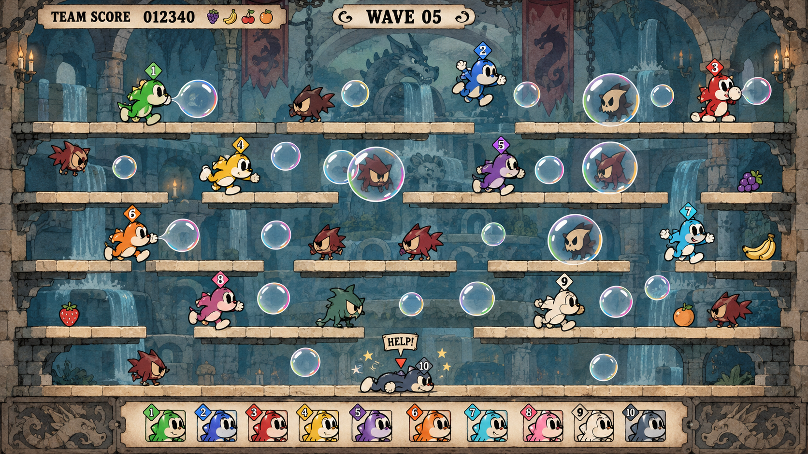
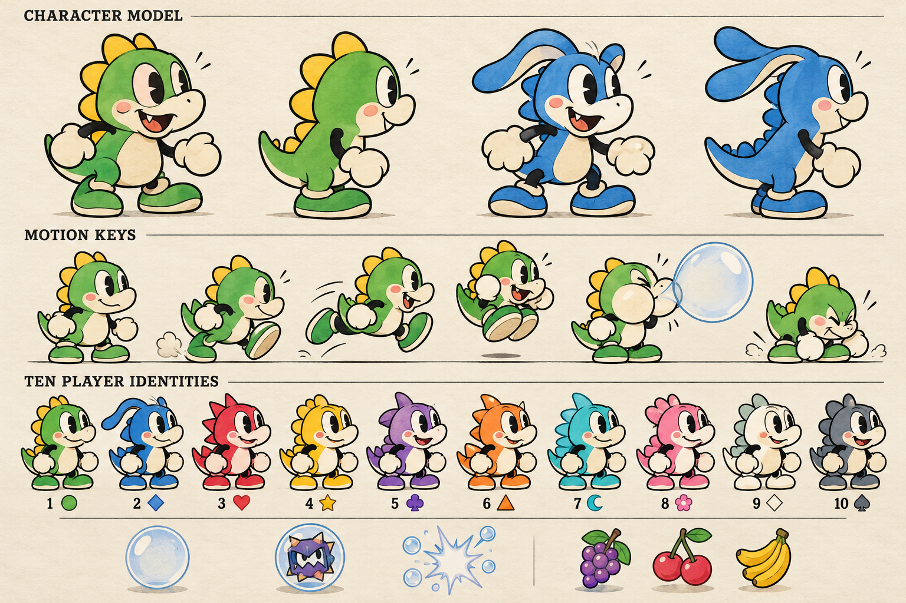
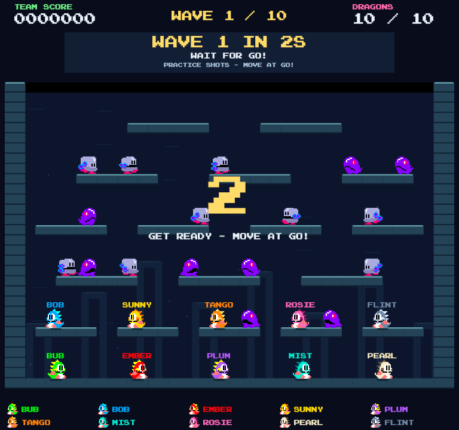

# Bubble Matinee — reskin investigation and concept art

20 October 2026. Coordinated investigation with three specialist subagents: current-art audit, historical/reference research, and rendering/multiplayer feasibility. Two original concept images were generated with the built-in image generation tool and visually reviewed. This package is an art-direction proof of concept, not an implemented playable reskin.

**Recommendation: proceed with a small playable slice.** The game can support a convincing ink-and-watercolor cartoon treatment. I can implement its presentation and asset pipeline. The main risks are consistent animation and ten-player readability, rather than the basic ability to render larger sprites. Cuphead-level animation polish remains substantial production work.

## The proposed look

An underground cartoon matinee: warm cream platform caps, muted blue-green painted masonry, friendly bubble dragons outlined in dark ink, pale faces and bellies, elastic limbs, expressive cheeks and transparent soap bubbles. Dark angular enemies contrast with the round heroes. The full arena remains the main composition; portraits and introductions can carry the large expressive drawings.

This is an illustrative 16:9 composition, **not an engine screenshot or an exact redraw of the current level**. Platform placement, body scale and HUD layout are proposals. It shows ten player bodies, but not a maximum-density combat stress test. The existing game can reach 32 enemies; this still has fewer and does not prove that load is readable.

The character board proposes two leading body treatments, six motion key poses, ten color/crest identities and bubble/pickup language. These are design keys, **not a registered animation strip**. Frames still need stable proportions, pivots, timing, alpha cleanup and in-game review. The blue dragon's longer crest/ears would need a compact combat pose to avoid overlapping the next platform lane.

## What the current art audit found

The active reference collection contains **265 PNGs**: 38 dragon frames, 129 enemy frames, 35 bubble/projectile/effect frames, 25 food icons, 12 power icons, 25 tiles and the original logo. All are packed into the production atlas. There are six ordinary enemy families and a separately sourced boss. The manifest has 95 animation/item entries containing 239 distinct frames; atlas rectangles and palette aliases must not be counted as separate original designs.

The wider media census contains 674 files, including screenshots, audio, font and build evidence. That is a filesystem inventory, not a claim that every file is a distinct game-art asset or that every animation was watched frame by frame. All 281 imported provenance hashes matched. The visual review used a representative state catalog, an all-atlas contact sheet and stored engine captures.

Classic has tiny saturated arcade sprites and patterned tiles. Party mode already has quieter masonry and clearer foreground separation, making it the better starting point. The present ten-player cast uses two stored dragon animation sets and palette aliases. Ten fully independent hand-animated characters would greatly increase the scope.

A coherent full reskin also covers the boss, captured/warning/angry enemy states, elemental effects, food/powers, logo, font, lobby, HUD, menus, results and editor previews. Replacing just the dragons would leave much of the original visual identity in place.

See the [complete audit](current-art-audit.md), [visual catalog](current-art-catalog.png), [all packed frames](all-atlas-frames.png), [media inventory CSV](asset-inventory.csv) and [animation inventory](animation-inventory.json).

## What to take from Fleischer and Cuphead

Take the **drawing and motion language**: curved limbs, simple strong silhouettes, cheek inflation, anticipations, squash/stretch, eccentric expressions and painted scenery behind crisp characters. Keep controls responsive while the drawings act around the actual gameplay events. A sepia or film-grain filter alone will not create the style.

Fleischer's own examples include both black-and-white work and the 1936–1939 color Popeye specials; a colored treatment is a reasonable historical direction. [Fleischer Studios process and color examples](https://fleischerstudios.com/magic).

Studio MDHR describes paper drawing/inking, digital color and watercolor backgrounds, with animation and gameplay running at different rates. That separation is the useful implementation principle. [Unity / Studio MDHR interview](https://gw-prd.hexagon.unity.com/made-with-unity/cuphead).

The supplied archive separates playable characters, enemies, stages, effects and HUD assets, reinforcing that this is a complete visual system. Its archive-item counts are not unique-frame counts or a required production budget. [User-supplied Cuphead archive](https://www.spriters-resource.com/pc_computer/cupheaddontdealwiththedevil/).

The concepts use newly generated dragon designs and scenery. Reference files were not imported into the game. See [sourced style research](style-research.md) for the specific inspected examples and distinctions between facts and design recommendations.

## Multiplayer: what changes and what stays difficult

The current implementation supports **ten local human/AI/empty slots**, defaulting to one human and nine bots. Classic also retains its one/two-player mode. No online transport or matchmaking implementation was found. Online multiplayer is a separate engineering project, not part of an art swap.

For 2–4 players, expressions and broad poses can have more visual prominence. For 6–10, keep a fixed shared arena and compact combat silhouettes. Following a single player or zooming toward the group midpoint can hide people, enemies and rescue targets at the opposite edge. Ten-way split screen would make the drawings harder to appreciate.

Higher source resolution and screen size are independent. The current ten-player layout displays a 48-world-unit dragon in roughly a **34-pixel envelope at 768×720**, or about 29 pixels in the tall test layout. A 256-pixel source improves edges but still shrinks to that envelope. The concept deliberately presents larger figures for art review; reproducing those apparent sizes requires more usable viewport space and/or a spacing redesign. I would first fit the art to current collision bounds, then evaluate a dedicated widescreen HUD/layout. I would not enlarge every actor and assume the existing passages still read correctly.

Use three identity cues: body color, a small distinct crest/ear shape, and a matching simple symbol in the HUD. The board demonstrates the direction; the arena still uses mostly diamond badges, so it does not yet meet that rule. Symbols should remain recognizable when small. Marking humans selectively may be clearer than keeping ten numbered labels over every head; this needs an actual group test.

Bubbles should have clear interiors, thin bright rims and restrained ownership accents. Trapped enemies, expiry, elements and rescue must keep their own semantic cues. Keep paint, texture and animated scenery subdued; short local pops are preferable to large clouds across several players.

## How difficult is it for me?

| Work | Difficulty | Assessment |
|---|---|---|
| Direction, palette, character/key-pose concepts | Low–moderate | Delivered here; useful for choosing the look. |
| Smooth sprite rendering and art manifest | Moderate | Add an opt-in filtered, alpha-blended presentation route reading the current simulation. |
| One convincing moving dragon and one enemy | Moderate–high | Integration is tractable; proportion, ink and timing consistency require repeated frame review. |
| Ten-player party presentation | High | Shared animation masters help cost; silhouettes, bubbles, overlaps and HUD need crowded in-engine iteration. |
| Whole-game production reskin | High | Content coverage and animation cleanup dominate. A generated concept is not a finished animation library. |
| Online multiplayer | Separate project | Networking, joining/reconnection and multi-machine tests are outside this reskin. |

The current renderer intentionally uses integer texture loads and CPU composition of partial-alpha texels. Its ordinary-frame packer limits source dimensions to 60 pixels. Dropping HD antialiased art into that route would retain unsuitable sampling and risk expensive edge composition. I would preserve Classic and add a cartoon presentation path, with normal GPU alpha blending and explicit animation timing/anchors.

For a cost-conscious cast, start with two master bodies and shared clips, then derive eight identities through controlled palette regions and compact crest/accessory variants. Do not tint the pale eyes and black ink along with the body. Ten completely unique acting libraries would multiply authoring and memory costs. For scale: one 2048² RGBA8 atlas is 16 MiB before mipmaps/copies, regardless of how small its compressed PNG is.

I can handle renderer integration, frame extraction/normalization tools, clip manifests, pivots/muzzle anchors, palette masks, camera/HUD integration, engine tests and iteration. I cannot honestly guarantee stable production animation or Cuphead's density of polished drawings from one automatic generation pass. A useful schedule estimate needs a measured renderer spike and one reviewed motion cycle first.

## The next concrete implementation slice

Build an opt-in cartoon theme with one courtyard, two polished dragons plus eight derivative identity treatments, one enemy family with its trapped/warning/escape states, bubble/pop/rescue effects and minimal HUD. Preserve gameplay timing, collisions, scores and AI.

Prove it using the same recorded engine inputs and simulation hashes, a cold engine viewport, and whole-board captures at native, wide, tall and ultrawide sizes. Include separated players, overlapping players, firing, capture, rescue, boss-scale obstruction and all ten slots. Measure presentation time, texture residency, transparent overdraw and draws against the existing 14-draw ceiling; validate low-tier device performance if phones remain a target.

The immediate art refinements are quieter background contrast, compact blue ears, consistent line weight, actual per-player symbols and clear bubble semantic states. Generated sheets need a motion pass before becoming imported assets.

## Validation and limits of this investigation

Completed: three subagent reports, media/animation census, original-asset hash verification, source/camera inspection, historical/reference research, visual review of current evidence and both generated concepts. The arena and character board agree on broad palette and character language but are not a locked production model pack. The arena also uses a single footer row rather than the requested two; that is a mockup deviation to resolve in actual layout.

No runtime or source art was replaced. No new game test suite, performance benchmark, physical-controller test, online test or human readability study was run. Existing documented performance figures are historical, and six mobile-tier render failures in the existing project report remain explicitly identified in [technical feasibility](technical-feasibility.md). This work makes no new frame-rate or hardware guarantees.

Both selected PNGs are saved alongside this report. The exact prompts and built-in generation mode are recorded in [generation-prompts.txt](generation-prompts.txt). The full engineering evidence and acceptance gates are in [technical-feasibility.md](technical-feasibility.md).
