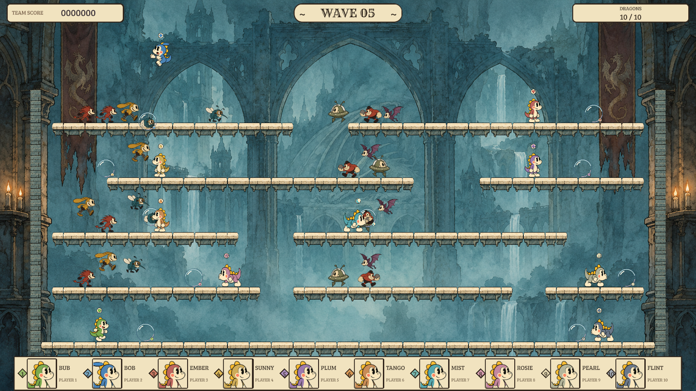

# Bubble Brigade — level and UI playable checkpoint

This checkpoint implements the approved level-design and HUD milestone. Open the project in the Game Engine editor, use the default `scenes/cartoon.scene.json`, and choose Brigade Survival. The default team is one human with nine AI teammates; the existing setup supports solo and local human slots. Controls and core rules are unchanged. Play this checkpoint before deciding the next character-art or animation pass.

## Implemented

- A 60×24 arena with five playable tiers, four shelf arrangements, two continuous ascent routes and two player starts per tier. The unchanged jump reaches every tier; broad overlaps provide alternate diagonal routes and recovery after missed jumps.
- Narrow visible side walls and thicker cream platform caps aligned with collision tops. The board fills the available width while preserving space above the highest jump and below the floor.
- Compact score, wave and team-status plaques; ten larger face portraits with numbered identities in one row on wide screens, and a five-by-two arrangement on narrow screens.
- Explicit rescue, returning and out states, brief start cues and a HELP plaque beside each downed actor. The rescue group stays below the header even at the highest jump.



The original [concept](../art-reskin-investigation/concept-ten-player-arena.png) guides the composition. This is a playable interpretation; character scale, animation and human readability remain feedback topics. `wide-combat-44x16.png` documents the rejected intermediate composition, not the delivered layout.

## Evidence

- [Stage design and measured composition](stage-design.md)
- [Logic, input, replay and render verification](verification.md)
- [Performance review](review.md) and [raw measurements](performance.json)
- [UI checks](ui-verification.json) and [original-file preservation](preservation.json)

The nine host performance scenarios peak at 12 draws against the unchanged 14-draw limit. Sampled JavaScript heap exceeds the generic 32 MiB guidance. These host measurements do not establish physical-phone GPU timing, sustained thermals, controller behavior or human group readability. The installed engine also lacks the Hermes test host. Existing historical pipeline warnings remain documented in the review.

Final development verification passes 301 V8 logic tests and all 60 desktop render cases. The 280 protected original gameplay traces remain identical without allowances, and the original 48 pixel render cases retain their baselines. Three new concept recordings verify 577 steps. Structural replay peaks range from 11 to 14 draws; the 14-draw limit is unchanged. The preservation audit confirms all 1,625 protected original files remain byte-identical.

The final [engine check](engine-check.json) passes typecheck, validation, desktop cook and 600 cooked smoke frames. All three checkpoint cases also pass on cooked content with phone-low residency enforcement ([report](cooked-render.json)). The historical stale material-program pipeline key remains a release-packaging warning; see the review for the exact limitation.

## Reproduce

Run these inside `bubble-boobble/`; run Git at the repository root. All automated gameplay verification uses the Game Engine.

```sh
python3 tools/cartoon/build-ui-portraits.py
gameengine test --filter 'concept *' --memory-class phone-low
gameengine test --tier t1 --gpu-tier desktop --filter 'concept checkpoint *' --memory-class phone-low
node tools/cartoon/overhaul-performance.mjs --all-tiers --out docs/concept-playable
gameengine check
```

Previous migration and overhaul evidence is retained unchanged. Original pixel scenes, data, recordings and render baselines remain available for comparison.
