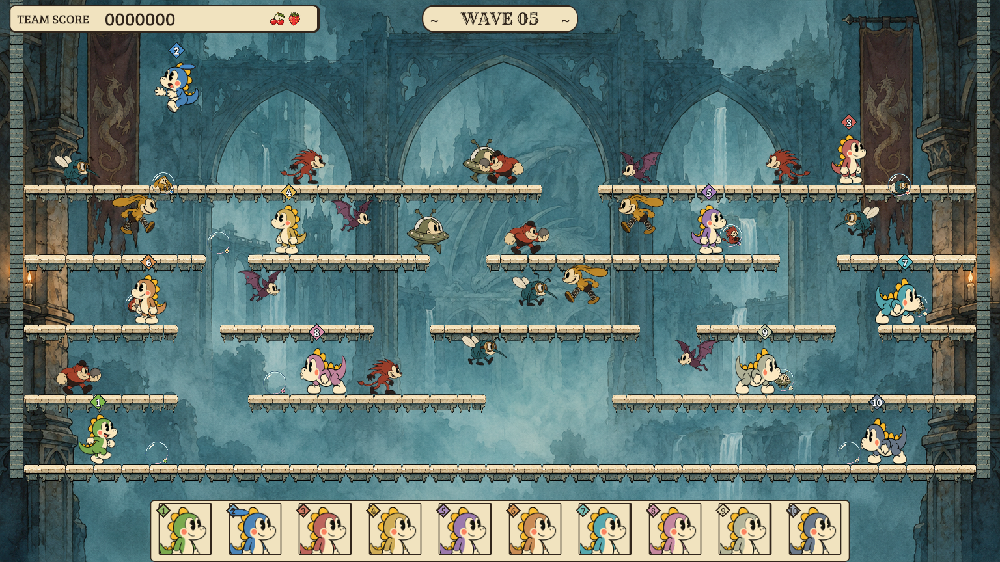

# Concept refinement: UI and level composition

The second comparison found substantial remaining differences in actor presence, shelf rhythm, side framing and HUD hierarchy. This pass refines those areas using existing artwork. Character drawings and animation frames are unchanged; gameplay sprites are enlarged in presentation around their established anchors. Controls, hitboxes, jump physics and core rules remain unchanged.

## Visible changes

- Wider playable stage framing, with the decorative backing excluded from the must-see footprint while preserving enlarged actor overhang at both walls.
- Five tiers with two, four, five and three shelf sections above the floor, matching the concept's section rhythm. Actual ascent lanes and an upper detour keep the authored gaps traversable.
- Existing player and enemy sprites at 1.6× presentation size; boss at 1.5×. Original API defaults and pixel rendering retain their existing sizes.
- Larger numbered world diamonds, a broader score plaque, contextual right-side status and a centered portrait-led footer. Wide faces are 64 logical pixels in an 80px footer; narrow screens retain the compact five-by-two arrangement.

See [the comparison](comparison.md) for the original differences and rejected platform trial, [verification](verification.md) for engine evidence, and [performance review](renderer-review.md) for measured costs and limitations. This directory preserves the new iteration separately from the earlier `concept-playable` checkpoint.

## Play and reproduce

Open the default `scenes/cartoon.scene.json` in the Game Engine editor and choose Brigade Survival. Default setup is one human with nine AI teammates. Existing solo, local-human setup, pause and restart routes remain available.

Run engine commands from `bubble-boobble/`, and Git from the repository root:

```sh
gameengine test --memory-class phone-low
gameengine test --tier t1 --gpu-tier desktop --memory-class phone-low
node tools/cartoon/overhaul-performance.mjs --all-tiers --out docs/concept-refinement
gameengine check
```

The concept is a static illustration. This implementation reserves space for the real full jump above the crown tier, so its crown position differs from the illustration. The background painting and character drawing styles also remain different. Physical-device GPU timing, thermals and human multiplayer readability require play feedback and device profiling. The historical release-pipeline warning remains a separate packaging limitation.

Final verification passes 305 V8 logic tests, 61 desktop render cases and all four cooked checkpoint cases across 713 steps. All 280 original gameplay traces remain identical without allowances; 48 original pixel cases retain their baselines. All 532 existing cartoon assets remain byte-identical, including character drawings and animation data. The engine check passes desktop cook and 600 cooked smoke frames. Host memory still exceeds generic low-end guidance; see the measured review before interpreting this as phone readiness.


