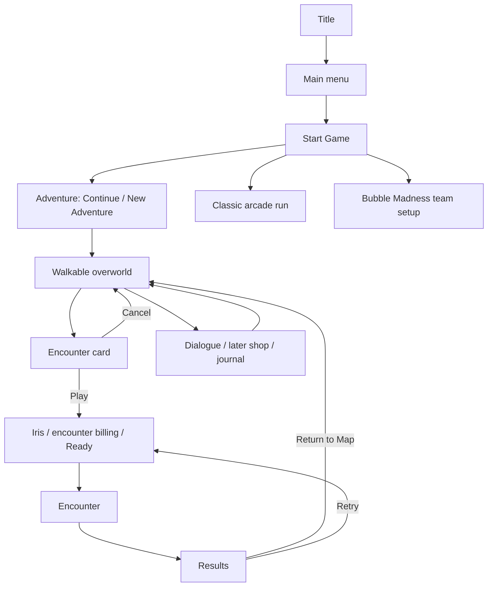

# Walkable overworld: Cuphead analysis and Bubble Brigade implementation plan

23 October 2026 · Proposal only · No gameplay implementation in this task

## Recommendation

Make a walkable overworld the home of a new Adventure campaign. The player controls their dragon between physical landmarks, chooses an encounter, plays it, and returns to the same place with visible progress. Preserve the current Classic arcade run and Bubble Madness as distinct activities so campaign exploration does not inherit their run-based scoring and restart rules.

Build one compact island with three existing encounters first. Expand to the full campaign only after movement, encounter completion, persistence and return navigation work together. Introduce shops, quests and special challenges in subsequent phases: these require actual reward and gameplay systems, not just map icons.

This request authorizes planning beyond the migration baseline. It does not implement a reskin, change multiplayer, or modify archived migration evidence. The working tree already contains ongoing UI and art edits; this proposal describes the current files on disk without treating those edits as committed or verified by this task.

## 1. What Cuphead's map contributes

The map combines navigation, recovery between difficult encounters, progression feedback and discovery. Its most useful design contribution is turning a level menu into a place the player remembers.

| Mechanism | Player experience | Implication for our game |
|---|---|---|
| Freely controlled avatar on bounded walkable ground | Choosing where to go feels like play | Implement ground movement and collision, rather than animating a cursor between nodes |
| Recognizable landmark entrances | Players remember the tree, dock or building | Give destinations distinct silhouettes and names, even when encounters initially share arena art |
| Interaction near an entrance | Moving and committing are separate actions | Show one contextual prompt; require a fresh confirm to open the encounter card |
| Several available challenges | A difficult encounter need not stop the session | Open two branches early and make prerequisites explicit |
| Completion markers in the world | Progress remains visible after leaving a level | Show cleared/reward-complete states at the landmark |
| Shop and NPC destinations | Exploration has uses beyond fighting | Connect them to real persistent systems when those systems exist |
| Shortcuts and hidden rewards | Geography becomes something to learn | Separate physical access from completion credit; secrets cannot grant required clears |
| Music, painted scenery and restrained interface | The map provides a change of pace | Keep combat HUD elements off the map and limit constant animation |

The view is best described as a stylized overhead 2D world with oblique scenery and foot-based layering. We can achieve that with layered sprites and authored walkable regions; a 3D world is unnecessary.

Do not copy every Cuphead rule. In particular, difficulty clears, access through an island, and final completion eligibility are separate concepts. The supplied summary overstates Regular-only gating between early islands: reference accounts describe Simple clears allowing earlier travel, while contracts are required for the final encounters. Our rules should be simpler and stated on the entrance card.

Evidence update: the user subsequently supplied the local video `/Users/eduardoleale/Desktop/Cuphead07072024-103131-9425.mp4` (3.834 seconds). Frames sampled every 0.25 seconds were inspected alongside the local collection previews. The observations below supersede the earlier limitation that the reference clip was inaccessible. General progression, shops and quests still rely on the supplied description and linked references. The short clip does not establish exact collision geometry, input bindings beyond displayed prompts, animation timing, camera damping or interaction distances.

### Observations from the supplied clip

| Approximate timestamp | Directly visible | Implementation implication |
|---|---|---|
| 0.00–0.50 s | Cuphead walks toward the tall yellow building; the scenery shifts while the avatar stays near screen center | A following camera is part of the reference experience. Test scrolling in the first island rather than postponing it until campaign expansion |
| 1.00–1.25 s | A high-contrast `A` button prompt appears immediately above the avatar at the building's door | Place a compact contextual prompt near the interacting avatar/entrance, with the current device's button glyph |
| Around 2.00 s | Cuphead is farther from the door, near the palm planting; the prompt is absent | Availability should follow proximity; approaching does not automatically enter the encounter |
| Around 2.50–3.00 s | The avatar returns to the door and the prompt appears again | Interaction state must update as the player leaves and re-enters, without becoming latched on |
| Around 2.00 s and 3.50 s | Foreground palm foliage overlaps parts of the avatar; the path remains readable | Author foreground occlusion and foot-based sorting separately from ground collision |
| Throughout | A coin counter is in the upper left and `EQUIP Y` is in the upper right; no combat health/score HUD is present | Keep map UI sparse and screen-anchored while the scenery scrolls. Add equipment access only once our game has equipment |
| During walking | Facing changes with travel direction and small white dust puffs appear around the feet | Use directional map animation and short-lived pooled footsteps/dust; keep these presentation-only |

The clip shows one entrance being approached repeatedly, not an entrance activation. It does not show a level card, difficulty choice, dialogue, shop, gate unlock, completion flag, loading transition or return from combat. Those parts of this plan remain proposed adaptations supported by broader references, not observations from this video. Scrolling is directly visible; whether Cuphead uses a specific dead zone, damping curve or map-edge clamp cannot be established from this clip.

Changes prompted by the video: make the first island slightly larger than the viewport, include bounded following immediately, put the contextual interaction glyph in world-relative presentation, and add a repeatable approach/leave/re-approach test. Keep an accessible encounter name in the contextual model so the glyph does not become the only way to identify a destination.

References:

- [User's Game UI Database reference](https://www.gameuidatabase.com/gameData.php?id=129&autoload=78461).
- [Cuphead Basics Guide: NPCs, shop and shortcuts](https://steamcommunity.com/sharedfiles/filedetails/?id=1310872602&l=dutch).
- [Difficulty and contract distinctions](https://cuphead.fandom.com/wiki/Difficulty_Rankings).
- [Inkwell Hell and final contract gate](https://cuphead.wiki.gg/wiki/Inkwell_Hell).
- Local source index: `/Users/eduardoleale/workspace/art/cuphead/INDEX.md`.

## 2. Current game: what this changes

| Existing implementation | Required integration |
|---|---|
| `src/desktop/state.ts`: title → menu → modes → Classic or party setup; start/restart requests hard-code level 1 | Add Adventure entry, overworld/modal states, selected destination and explicit return context |
| `src/arcade/engine.ts`: start creates the full campaign; request `level` is not used to select an encounter | Add a validated encounter request with stable encounter ID and explicit session kind |
| `src/arcade/game.ts`: `createGame` starts at the first supplied level; clearing automatically loads the next | Use an explicit one-encounter session contract; return a scoped completion result |
| `src/desktop/save.ts`: version-1 profiles store aggregate score, rounds and run statistics | Add versioned per-profile Adventure progress without converting arcade high scores into Adventure completion |
| `src/desktop/model.ts`: pause/results offer restart-run and main-menu actions | Derive labels and actions from session kind; Adventure gets Retry Encounter and Return to Map |
| `src/desktop/controller.tsx`: billing text assumes Classic round 01 or Madness wave 01 | Drive billing from the selected encounter; preserve iris, Ready and input-release protections |
| `src/arcade/presentation.ts`: shared rendering path and initial `WorldView` setup | Add explicit map rendering/camera ownership; suppress retained arena visuals while on the map |
| `src/cartoon/arena.ts`: existing campaign content is transformed into the same courtyard geometry | Existing rounds can prove navigation, but 25 landmarks alone will not create 25 visually distinct encounters |
| `src/arcade/party.ts`: Madness includes its own wave and boss progression | Keep that loop intact; a map gateway may open existing team setup later |

Do not use `custom`/playtest mode to implement Adventure. It has editor and save semantics that would contaminate completion and return behavior. Do not add overhead movement to the side-view combat player controller.

## 3. Proposed UI/UX flow



Adventure becomes the first Start Game choice. On a fresh profile it enters the first island near a guide; on a returning profile it resumes at the saved safe location. New Adventure on an existing save requires a clear destructive-reset confirmation. Mode navigation must accommodate the extra choice rather than relying on the current two-card selection geometry.

Map HUD: district name, cleared/required count, contextual interaction prompt and a compact pause/options entry. Add currency only when spendable rewards exist. A later journal lists discovered encounters, completion and gate requirements; it supplements the walkable world and provides a quick route back to known content.

Encounter card: destination name and illustration, challenge type, completion status, expected reward and Play/Back. Initially show one supported ruleset. Do not display Simple/Regular/Expert choices before distinct, tested difficulty configurations exist.

On success, persist the clear before results become actionable. Return to the entrance's safe anchor, reveal its completion marker and explain newly available routes once. On defeat, default to Retry Encounter; Return to Map remains visible. Retry retains encounter identity and ruleset. Cancelling the card restores position and facing.

Pause inside Adventure offers Resume, Retry Encounter, Options and Return to Map. Map pause offers Resume, Options and Main Menu. Options returns to its actual caller. Extend the current `settingsReturn` handling beyond menu/pause and keep encounter pause separate from map pause. Leaving an unfinished encounter never grants completion.

Classic retains full-run behavior and its existing statistics. Madness retains team setup, wave progression and team results. A Madness gateway on the map, if added, returns to that gateway and does not silently award Adventure campaign progress.

## 4. First island and progression

First playable scope: one compact island slightly larger than the viewport, a bounded following camera, one controllable dragon, three encounter entrances, one guide NPC, one discoverable shortcut and one exit gate. Use existing rounds 1–3 as encounter content. These remain bubble combat encounters, rather than being described as Cuphead boss fights.

Suggested geography:

```text
                   [Encounter C] -- [Exit gate]
                         |               |
 [Encounter A] ----- [Crossroads] --- [Encounter B]
        \                 |              /
         \---- hidden side path --------/
                          |
                     [Guide / spawn]
```

A and B are available immediately. Clearing either opens C. Clearing all three opens the exit gate; during the slice the exit shows a completed-island summary rather than loading an unbuilt island. The shortcut connects branches early but cannot satisfy the exit's clear requirements. Gate text lists what remains, with encounter names.

Use authored walkable polygons or a small navigation grid aligned to scenery. Decorative bridges, water and foreground foliage have separate collision and visual layers. The avatar collides by its feet, slides along boundaries, and cannot enter props. Hide interaction prompts during dialogue, pause and transitions.

Desktop controls: WASD/arrows or gamepad stick/D-pad to walk, confirm button to interact, Back/Escape to cancel or pause. Normalize diagonal movement deterministically and use a dead zone and hysteresis for gamepad facing. In the first version, mouse operates menus/cards; click-to-walk is a later navigation feature. Avoid ambiguous automatic entrance activation.

One profile owns the map and one avatar navigates it. Existing supported combat team modes can be passed into encounters after their save ownership is tested; the initial slice uses solo. This does not introduce multiple walking players or new network behavior.

Full-campaign expansion: provisionally group the 25 existing rounds into five districts of five encounters. Treat this as a content-planning starting point, not a claim that the current rounds support a five-world difficulty arc. Audit enemy mix, elemental teaching and encounter duration before fixing membership. Each district should offer a branch, a memorable landmark and a gate requiring named core clears. Optional content never blocks the main route.

## 5. Feature mapping beyond the slice

| Cuphead feature | Bubble Brigade adaptation | Delivery dependency |
|---|---|---|
| Level/boss selection | Landmark cards for existing combat; later distinct boss encounters | Selected-encounter runner first; current boss is embedded in Madness |
| Run 'n Gun entrances | Optional bubble traversal or elemental challenge stages | New authored challenge content and explicit success criteria |
| Shop | A vendor with a defined catalog, prices, owned state and purchase feedback | Dedicated persistent currency; combat score is not money |
| Weapons/charms | Later bubble modifiers or utility upgrades | Separate balancing and combat integration; no empty equipment UI |
| NPC quests | Guide dialogue, then a small objective/reward loop | Persisted objective events, dialogue state and one-time reward claims |
| Mausoleums | Bubble mastery trials teaching capture, popping or elemental skills | Purpose-built trial rules; rewards need an implemented use |
| Hidden shortcuts | Traversable concealed connections | Navigation data plus discoverable environmental cues |
| Hidden collectibles | One-time map pickups with persistent IDs | Collect/claim handling, currency purpose and save migration |
| World travel | Gates between districts, return travel and saved entry anchors | Data-driven prerequisites and safe arrival points |

For the first economy pass, prefer cosmetics or optional utility over mandatory purchased power. Required encounters must remain beatable after any valid purchase history. Decide reward amounts through economy simulation; do not invent a coin balance from the current score curve. Replaying a level can improve a best result, but cannot repeat a first-clear reward.

## 6. Technical design and file boundaries

Proposed new modules; names are implementation guidance, not existing APIs:

- `data/overworld/island-01.json`: stable district, entrance and route IDs; walkable geometry; spawn/return anchors; POI interaction radii; prerequisites and encounter references. Keep visual positions separate from unlock rules.
- `data/encounters.json`: stable encounter IDs mapped to existing level IDs, session kind, title, ruleset and reward definition. Validate references and prerequisite cycles before boot.
- `src/overworld/state.ts` and `systems.ts`: authoritative `defineDoc` map state, fixed-step movement, collision, facing, interaction focus and intent validation. Use engine schema components/events where appropriate; run `gameengine gen` for schema changes.
- `src/overworld/progression.ts`: pure availability and gate rules derived from completed encounters, separate from discovered routes.
- `src/overworld/presentation.ts`: read-only visual lowering, foot-position depth ordering, landmark markers and pooled effects.
- `src/overworld/controller.tsx` plus thin views: fill models and emit intents; views never read the world or decide purchases/unlocks.
- `ui/docs/overworld-hud.ui.json`, `encounter-card.ui.json`, `overworld-dialogue.ui.json`, later journal/shop documents: create/edit only through `gameengine ui doc`, then generate typed bindings.

Extend `DesktopGameRequest` with explicit session kind and encounter identity. Resolve the level from validated content in sim; do not trust arbitrary UI indices. Store an active attempt record containing encounter ID, ruleset, owning profile, seed and return anchor. Block profile changes while an attempt is active, or explicitly close it first.

For the slice, run the selected level as a one-element campaign through existing `createGame`, preserving its authored level number. Its terminal `Won` means encounter completion only because the enclosing session is `adventure-encounter`. Full Adventure completion is derived from required encounter IDs. A future multi-round encounter can provide an explicit ordered level list.

Use one authoritative completion path from terminal game state. Persist a result receipt and first-clear changes together, and reject duplicate completion/claim requests. Results UI, Retry and Back must not dispatch a second legacy run-stat record. Legacy `best_round` and `won` currently assume a 25-round run; keep them scoped to Classic and give Adventure separate records.

Camera implementation begins with `gameengine camera list`. Use bounded `WorldViewFollow` in the first slice, with avatar scale and visible context tuned across aspect ratios. Keep important entrance interactions clear of HUD reservations; clamp at map edges and provide enough background bleed for the widest view. Restore combat framing when entering an encounter. Only one mode owns `WorldView` at a time. Presentation cameras and screen coordinates must not feed map movement/collision. Use recorded world input for any future pointer navigation. Bounded following is our implementation recommendation; exact follow/dead-zone settings are not recoverable from the video.

Keep all authoritative state in engine documents/resources/meta, driven by recorded input and `ctx.dt`/`ctx.step`. No mutable module state, wall-clock timing or view-animation completion as gameplay authority. Cover transition commitments with sim timing and preserve the existing release-before-action latch across map/card/combat boundaries.

## 7. Persistence and asset plan

Extend the existing version-1 save to version 2 with an explicit migration. Store Adventure progress per profile: current district and safe anchor, completed encounters keyed by ID, best encounter results and discovered routes. Add claimed rewards, wallet, inventory and quest state only when their features ship. Never infer clears from `best_round`; older profiles start Adventure fresh and retain all existing statistics/settings/custom levels.

Persist at meaningful boundaries: entrance commitment, completed encounter, collected reward and district travel. Keep walking coordinates transient; Continue restores the last safe anchor. On reload during an unfinished encounter, return to its entrance without a clear. Handle removed anchors by falling back to the district spawn. Disable Continue/claims while meta is loading and surface save errors without overwriting an unreadable save.

The local reference library has useful separated material:

| Collection | Reference use |
|---|---|
| `181707` Inkwell Isle I; `182235`, `182301`, `182369` other isles; `182342` Hell | Terrain layering, paths, boundaries and district composition |
| `161300` Overworld Locations | Entrance silhouettes and visual identity |
| `102765` Level Flags | Persistent completion markers |
| `97184` Cuphead Overworld; `98593` Mugman Overworld | Directional walking, foot anchors and facing transitions |
| `161450` Overworld NPCs; `113172` Tooltips / Overworld Portraits | NPC staging and contextual dialogue |
| `102764` Player Dust; `152256` Iris Transition | Small movement feedback and travel presentation |

The inspected Cuphead overworld collection includes five base view directions with idle/walk sequences; mirroring can supply opposite lateral directions where appropriate. Sequence timing is inferred/unverified in the library. Our dragon currently has side-view combat animations, so directional overhead dragon art is a real production requirement. Use a simple directional proxy during the slice, then author coherent dragon map poses and landmark/environment art. Reference assets remain outside the repository during planning; any later import must be an explicit selected subset with provenance and import metadata.

Separate ground, behind-avatar scenery, depth-sorted props/characters, foreground occluders and UI. Make the foot pivot consistent between frames. Use contact shadows and modest occlusion so paths stay legible. Do not construct the map from a single flattened image with guessed collision.

Load one district's art at a time with a small shared UI/avatar group. Budget encounter/map transition peaks, atlas map props, reduce ambient loops on low tiers and keep idle animation in short bursts. The library's 7.61 GB is reference material, not a shipping asset set. Target phone-low's 33 ms frame budget as required by repository guidance, despite current platform declarations being desktop/web. Actual memory and draw limits must be recorded in project budgets after measuring the slice.

## 8. Delivery sequence and acceptance gates

| Phase | Work | Done when |
|---|---|---|
| 1 — Integration contract | Encounter registry, session kind, v2 save migration, scoped result handling | A selected existing round starts, clears once, retries itself and returns to its entrance; old saves and Classic still behave correctly |
| 2 — Playable island | Proxy dragon, bounded movement and following camera, three POIs, NPC, shortcut, gate, HUD/card | Full input-driven map → encounter → result → map journey works; gates cannot be bypassed by direct intent; approach/leave/re-approach reliably shows/hides the contextual glyph |
| 3 — Visual and UX pass | Authored map/avatar assets, depth sorting, completion markers, camera fit, audio, responsive menus | Landmarks and paths are legible across supported sizes; return transitions and input latches pass rendered checks |
| 4 — Campaign expansion | Audit all 25 rounds, author district layouts, journal, travel and resume | Every required encounter is reachable; no prerequisite cycles or stranded save locations; all districts fit memory budgets |
| 5 — Side content and economy | Collectibles, vendor, one quest, mastery trial; later upgrades/difficulty/boss destinations | Each destination has real content, one-time rewards, valid persistence and no mandatory purchase soft locks |

Phases 1–3 are the first implementation milestone. Phase 4 makes it a complete campaign navigation feature. Phase 5 supplies the broader Cuphead-style hub functionality. Art production, new challenge design and economy balance are separate work from wiring the existing rounds; estimate them after the playable island establishes requirements.

## 9. Verification and known constraints

All automated gameplay verification uses Game Engine tests, recorded input/replays, headless sessions, view renders and render probes. No standalone build launch, desktop probes, browser/computer automation or synthesized OS input for playtesting. Engine tests cannot establish OS-level focus or controller behavior; report that limit.

Required behavioral coverage:

- Cardinal/diagonal speed, boundary sliding, bridge passage, shortcut traversal, stable POI selection and interaction hysteresis.
- Reproduce the video's entrance approach/leave/re-approach sequence: prompt appears only in range, disappears outside it and returns on re-entry; scrolling keeps the prompt attached to the intended target while corner HUD elements remain fixed. Verify camera bounds at all map edges.
- Modal input blocks walking; held confirm cannot enter a level, fire on spawn or reactivate a card on return.
- Selected encounter loads the correct content and billing; victory, defeat, retry, abandon and options return preserve context.
- Clear and reward are committed once; repeat results/claims, profile changes and stale intents cannot duplicate progress.
- Old version-1 save migrates; delayed/failed load, profile isolation, new-game reset and interrupted attempts behave as specified.
- Every gate checks requirements in sim; validate the entire prerequisite graph and distinguish route discovery from clears.
- Classic's 25-round progression, custom-level editor return and Madness team/boss flow stay covered by their existing regression tests.

Capture T1 frames for the map, near-entrance prompt, locked card, dialogue, cleared landmark, gate unlock and iris endpoints. Check desktop 4:3, 16:9, 21:9 and small windows; include landscape notched phone/tablet presets already used by the repository. Assert safe-area bounds, readable text, visible avatar and correct map-to-combat framing with `input.view`, not merely screenshot dimensions.

Record a deterministic journey from fresh profile through both branches, shortcut discovery, first clear, retry, save reload and gate unlock. Run T0/T1 and phone-low checks; run cross-runtime lanes where installed. Measure `perf.stats`, `render.stats`, asset memory and transition peaks; extend `tests/budgets/` with a specific overworld budget. Record the new presentation flows in `pipelines.json`, then run `gameengine check`, respecting the live-editor native-build exclusion.

Existing status documentation reports unresolved broad T1 differences, missing Hermes, an unmatched pipeline warning and unmeasured device GPU/thermal/peak memory. Those are historical reports, not checks rerun for this plan. Re-establish the live baseline before implementation, classify failures, and preserve historical migration/replay evidence. No blanket golden replacement.

The first milestone succeeds when a player can walk to either of two available landmarks, finish an encounter, return to its completed marker, choose another route, and resume later without losing or duplicating progress.
