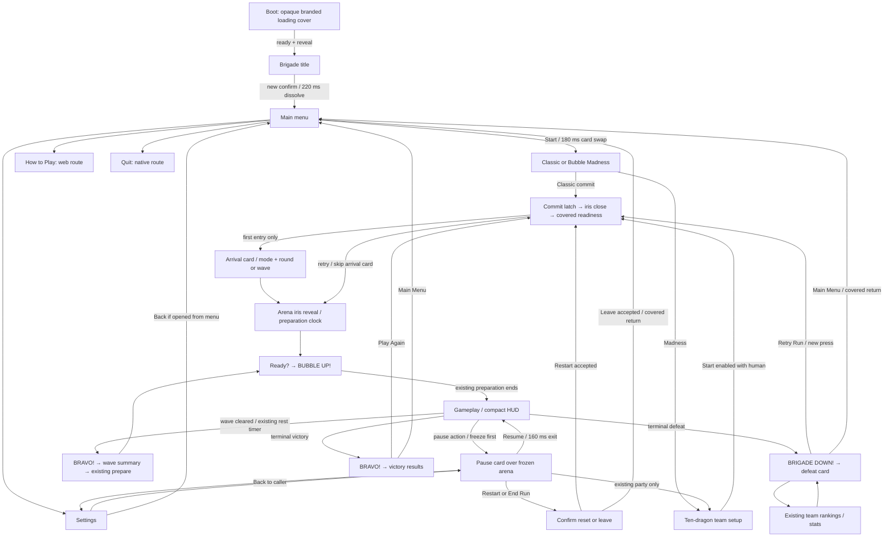

# The Bubble Brigade — Cuphead UI/UX blueprint

22 October 2026 · Proposal only · No implementation or production artwork changed

The closest practical match is a **theatrical sequence of illustrated cards, compact inked HUD information, emphatic hand-lettered action cues, circular scene reveals, and a defeat card built around retry**. Keep the Brigade logo, dragons, courtyard, modes, scoring, rescue rules, and run reset semantics. Rebuild the presentation grammar around those things. Simply adding film grain to the existing paper panels would leave the largest differences intact.

Recommended first implementation slice: Bubble Madness launch → existing three-second preparation → combat → terminal team defeat → retry the same run configuration. This exposes the main architectural and interaction questions before restyling every menu.

## Visual revision 2 — follow Cuphead directly

The initial schematic drawings were too far from the reference. Their cream rectangles, Georgia/serif cue lettering and generic scale-pop animation are superseded. The mechanics, navigation, input gates and verification requirements below still apply; use the visual revision below for presentation.

This is an AI-generated visual concept using the built-in imagegen tool, not an engine render. Scene and HUD details may be redrawn; the original engine capture remains authoritative for geometry, characters and gameplay. [Detailed revised visual specification](/Users/eduardoleale/workspace/tactile-game-engine/the-bubble-brigade/bubble-boobble/docs/ui-ux-cuphead-proposal/VISUAL-REVISION-2.md). The exact generation prompt is saved in `intro-v2-prompt.txt`.

## How to read the evidence

- **[O] Observed:** fresh engine image, current UI document output, or executed test. A rendered sample establishes appearance only; it does not prove the real flow.
- **[C] Code-established:** source establishes a state, rule, or numerical value; unexecuted branches remain unverified behavior.
- **[A] Asset-established:** Cuphead pixels, named states, or numbered files. Does not establish navigation, easing, duration, playback order, or input acceptance.
- **[P] Proposed / inferred:** design interpretation or starting estimate. All proposed timings below are [P] unless explicitly marked otherwise. They are not measured Cuphead timings.
- **[V] Primary testimony:** direct statement by Cuphead's creator, attributed below. It is not a frame-by-frame measurement of the shipped UI.

### Research limits and primary sources

The local collection index and thirteen relevant collection detail pages were read, and their representative contact sheets inspected. Exact paths are listed in the reference register below. Some collections mix releases, DLC, localized variants, and unused art; avoid combining them into an invented single Cuphead flow.

Primary-material research found the [official launch trailer](https://www.youtube.com/watch?v=7jvRoNPBHjk), [Studio MDHR press kits](https://studiomdhr.com/press-kits/), and [Studio MDHR's trailer announcement](https://studiomdhr.com/cuphead-coming-in-2016-exclusively-to-xbox-one-and-pc/). The video fetch was throttled; no frame-accurate playback inspection was available. The press-kit page was accessible initially but subsequent fetches timed out. Therefore **Cuphead scene order, focus rules, precise cue timing, and exact input-release moments are not verified here**. The [Game Informer Gamescom capture](https://www.youtube.com/watch?v=iMkCIdGikmk) is a useful direct gameplay recording for follow-up, but is pre-release and was not inspected in playback. None of these links is used as proof of an unseen sequence.

One primary interview does establish an animation principle: Chad Moldenhauer describes character translation at 60 fps with animation held at 24 fps. This supports separating art cadence from game responsiveness; it does not establish that UI, iris, or hourglass sequences all run at 24 fps. [TIME interview with Chad Moldenhauer](https://time.com/4123150/cuphead-preview/), 12 April 2016. [V]

Before claiming a measured Cuphead match, inspect a shipped-version capture and log timecodes for title→menu, stage selection→loading→arena, Ready→Wallop, final death→card→Retry, pause/options, and win→results→return. Record platform/version, video fps, first/last visible frames, first accepted input if visible, and uncertainty. Hidden input rules require a primary manual/developer statement or instrumented reference capture; footage of a press cannot prove earlier presses would fail. This is a targeted evidence gap, not permission to infer exact behavior from numbered sprites.

## 1. Current inventory and assessment

Current configuration: `scenes/cartoon.scene.json`; `platforms: [desktop, web]`; landscape UI reference 768×720. iOS/Android target entries exist, but mobile is not currently declared in `platforms`. Existing mobile render tiers disable HDR and use MSAA 1. [C: `project.gameengine.json`]

Black areas in HUD-only samples above are empty scene backgrounds, not a gameplay rendering defect. Paper screens, however, really remain a centered near-square card in these 1280×720 view renders. These are fresh views with authored sample models, not live screenshots of every state.

The real engine frame shows why Cuphead's two-player HUD cannot be copied literally: ten dragons, five platform tiers, rescue status, team score, and wave information compete for space. Preserve the whole arena and the numbered/color-linked roster. [O]

| Screen / route | Current evidence and strength | Weakness / implication |
|---|---|---|
| Boot → title | Start scene is cartoon; large illustrated Brigade logo, paper border, blinking Enter prompt. `CartoonMenu/title` render. Enter and short Enter taps tested on original arcade scene. | Fixed near-square composition leaves broad black margins on widescreen. Title prompt is keyboard-only. No game-specific cold-loading presentation established. |
| Title → main | Shared CartoonMenu view; titleMode switches logo size and menu visibility. Start Game, Settings, Quit; web substitutes How to Play. `cartoon-menu` transition is Instant. | Abrupt hierarchy change. Strong rectangular selected fill reads as a generic list rather than a drawn pointer directing attention. |
| Main → mode | Classic and Wave Survival illustrated panels, Left/Right navigation. UI label also differs from model's Bubble Madness name. | Clear two-choice structure worth keeping; mode naming needs one agreed label. Classic launches immediately on confirm; no common arrival card. |
| Mode → team → launch | Ten slot cards cycle human/AI/empty; at least one human required. Start Survival. Pause can reopen team setup and resume. | Small role text and cycling roles hide the next change; start constraint is a transient status instead of a clearly disabled action. Ten slots are a real mechanic, not a reskin opportunity. |
| Level entry | Request changes screen to play directly. Party starts in prepare for 180 ticks; first-wave movement/jump held, practice fire allowed, combat at zero; 120-tick invulnerability grace. Existing test verifies prepare→combat at tick 180. | Countdown, top wave plaque, banner and cue compete. No dedicated iris/loading/arrival owner. Must not hide the arena so long that preparation information is lost. |
| Gameplay HUD | Team score and wave across top; ten framed dragon portraits below; rescue/boss/last-dragon states; top banners. Fresh gameplay render and HUD samples. | Ornamental roster rail consumes height; tiny countdown overlaps the wave plaque; repeated GO/banner messages dilute the action cue. Use event hierarchy rather than another decorative layer. |
| Controls / help | Keyboard, gamepad, second-player keys documented in `model.ts`; browser-specific scripts also exist. Help is a text-heavy shell. | Full action set is learned from a dense text block. View samples do not prove browser touch input. No verified in-arena touch pause control in this inspection. |
| Pause | HUD stays mounted; opaque paper shell with Resume, Restart, End Run; Team Setup in party. Engine flow run reached pause and resumed; checks assert gameplay Tick freezes. | Scene context disappears behind another full page. No Settings entry in pause menu today. End Run is adjacent to Restart with no confirmation branch in `desktopAction`. |
| Settings | Dragon, music, sound, fullscreen, play mode, effects, Back; rows use focus fill. Effects saves reducedEffects. | Mixes identity, run setup and presentation settings. No caller-aware return: Back routes to menu. Fullscreen can be unsupported and reported via status. Reduced effects currently gates victory confetti, not a demonstrated global reduced-motion contract. |
| Defeat | CartoonResults; headline GAME OVER, score, podium, team rankings, Play Again/Main Menu. Input arms after ≥45 sim ticks AND neutral controls. | Victory-style ranking dominates the recovery decision. Defeat and victory are barely differentiated. “Play Again” does not communicate that the whole run resets. |
| Victory / results | Same layout; Boss Defeated headline, podium, rankings, confetti when full effects. Classic uses own scores/profile data. | No strong victory punctuation before analysis. Generic shared layout misses Cuphead's distinct fight outcome / results grammar. Do not invent grades, parry scores or clear-time stats absent from our model. |
| Retry / leave | `restart` reconstructs classic at level 1 or party at wave 1 with current team slots; custom retries custom level. `leave` records where appropriate and returns menu/editor. | This is not checkpoint retry. Preserve save/record-once rules. Confirm that caller intended a full-run reset before finalizing RETRY wording. |
| Loading / transitions | Engine supplies `gameengine.LoadingView`; no use of `loading.run` in inspected current desktop controller. Most screen documents have empty Enter/Exit and Instant transition; button is Ease out 120 ms; HUD property transition is Back 240 ms. | A per-widget transition setting does not establish a full scene sequence. Loading, navigation ownership, neutral input gates and error recovery need an explicit coordinator. |
| Profiles, scores, credits, editor | Existing routes, keyboard entry, custom-level authoring, help/credits. Flow test visits these routes through emitted intents. | Keep available routes and semantics. Do not insert Cuphead save-slot deletion or equipment/loadout systems. Some routes are development-dependent; visit-by-intent is not proof of normal menu discoverability. |

Source map: `src/desktop/controller.tsx` (view routing/HUD mounting), `state.ts` (intents, keyboard latches, result gate), `model.ts` (buttons/labels), `src/cartoon/menu.view.tsx`, `screens.view.tsx`, `hud.view.tsx`, `hud-model.ts`, `src/arcade/party.ts`, `party-config.ts`. Exported document evidence is under `evidence/cartoon-*.json`; this was obtained through `gameengine ui doc show`, not edits to JSON.

## 2. Cuphead comparison and reference register

[Initial schematic comparisons — superseded visual treatment](/Users/eduardoleale/workspace/tactile-game-engine/the-bubble-brigade/bubble-boobble/docs/ui-ux-cuphead-proposal/annotated-comparisons.jpg)

The center column is extracted artwork, not a reconstructed Cuphead screenshot. The right column is an initial schematic using our arena/dragon art. Its paper-backed cue style is rejected; revision 2 above replaces that visual direction.

All paths below are relative to `/Users/eduardoleale/workspace/art/cuphead/`. Collection pages provide full original provenance links to The Spriters Resource; the library is secondary asset extraction evidence, not a behavioral authority. Files stay outside the production asset tree.

| ID | Local collection / exact specimen | What it supports [A] | Transfer to Brigade [P] |
|---|---|---|---|
| R1 | [143862-title-screen](/Users/eduardoleale/workspace/art/cuphead/collections/143862-title-screen.md); `extracted/menus/143862-title-screen/Cuphead/Title Screen/` | Illustrated title cast sequences and full-frame title background. | Logo-led composition with cast vignette and one action prompt; full-bleed backing behind safe-area content. Keep Brigade title art. |
| R2 | [116313-main-menu](/Users/eduardoleale/workspace/art/cuphead/collections/116313-main-menu.md); `extracted/menus/116313-main-menu/Cuphead/Main Menu/Save Select/` | Separate unselected/idle, excited, OK, wink character artwork and save selection panels. | Neutral, focus, press/commit, unavailable and return states need authored appearances. Do not assume their actual playback conditions from names. |
| R3 | [460635-miscellaneous-menus](/Users/eduardoleale/workspace/art/cuphead/collections/460635-miscellaneous-menus.md); `extracted/menus/460635-miscellaneous-menus/Cuphead/Miscellaneous Menus/Controls Menu/` | Ruled settings panels, checkmarks, arrows, control-button outlines. | Inked option rows, value arrows, checked states, clear nested remapping sheet if existing actions need it. |
| R4 | [261200-common-hud-elements](/Users/eduardoleale/workspace/art/cuphead/collections/261200-common-hud-elements.md); `extracted/hud-elements/261200-common-hud-elements/Cuphead/Common HUD Elements/Health/hud_hp_3.png`; `Dialogue Bubble/Cursor/Idle/hand_cursor_boil_0001.png` beneath same folder | Compact health glyphs, selection hand, highlights, dialogue pieces. | Compact persistent status; a drawn Brigade pointer as focus carrier. Do not map lives onto HP if semantics differ. |
| R5 | [161282-title-cards](/Users/eduardoleale/workspace/art/cuphead/collections/161282-title-cards.md); `extracted/hud-elements/161282-title-cards/Cuphead/Title Cards/Card/title_card_background.png`; `Inkwell Isle I/title_card_veggie.png` under same root | Title-card frame, separately authored stage lettering, billing marks, localization variants. | “The Bubble Brigade / in / Courtyard Caper / Wave 01” hierarchy, with real mode/wave info. No unimplemented difficulty selector. |
| R6 | [113172-tooltips-overworld-portraits](/Users/eduardoleale/workspace/art/cuphead/collections/113172-tooltips-overworld-portraits.md); `extracted/hud-elements/113172-tooltips-overworld-portraits/` | Eleven circular portraits; no animation sequence established. | Portrait + one immediate action hint. Do not infer tooltip dwell or navigation from these files. |
| R7 | [98810-loading-hourglass](/Users/eduardoleale/workspace/art/cuphead/collections/98810-loading-hourglass.md); `extracted/hud-elements/98810-loading-hourglass/Cuphead/Loading Hourglass/Loading/HOURGLASS_NEW_001.png` | 53 numbered new-hourglass frames; old/unused and nightmare art are separate. | Original hourglass-shaped bubble timer; lower safe corner on opaque loading field; no fake percent. 53 files do not prove duration or loop cadence. |
| R8 | [102767-fight-text](/Users/eduardoleale/workspace/art/cuphead/collections/102767-fight-text.md); `extracted/screen-overlays/102767-fight-text/Cuphead/Fight Text/` | Ready, Wallop, KO, Bravo, You Died sequences with emphatic silhouettes, stretch and fading frames. | Two-stage Ready? → BUBBLE UP!; terminal BRIGADE DOWN!; BRAVO! on clear. Original wording and lettering. Sequence group names suggest intent, not exact order/timing. |
| R9 | [152256-iris-transition](/Users/eduardoleale/workspace/art/cuphead/collections/152256-iris-transition.md); `extracted/screen-overlays/152256-iris-transition/Cuphead/Iris Transition/irisA_0000.png` through `irisA_0016.png` | 17 aperture images from closed/small to open/large, inspected in contact sheet. | True circular closure/opening over arena; full opaque cover during reset. Direction reversal, center and easing are proposed until footage verifies them. |
| R10 | [97596-screen-fx](/Users/eduardoleale/workspace/art/cuphead/collections/97596-screen-fx.md); `extracted/screen-overlays/97596-screen-fx/cuphead_screen_fx_0000.png` and numbered neighbors | Vignette/light-field/film-like surface variation. | Slight edge patina, brief authored flecks; no constant flicker on low tier. Blend mode and runtime opacity not established by the pixels. |
| R11 | [161855-win-screen](/Users/eduardoleale/workspace/art/cuphead/collections/161855-win-screen.md); `extracted/menus/161855-win-screen/Cuphead/Win Screen/BG/winscreen_bg.png`; `Banner/`, `Star/Appear/`, `Effects/Puff/` under same root | Radial result background, distinct lettering, banner/star/puff states. | Victory-only celebratory field and staggered existing metrics; keep team recognition and all ten rankings available in Details. |
| R12 | [97983-death-cards](/Users/eduardoleale/workspace/art/cuphead/collections/97983-death-cards.md); `extracted/hud-elements/97983-death-cards/Cuphead/Death Cards/death_card_bg.png`; `death_card_marker_0001.png` | Tall ornamental card, portrait variants, runner/marker images. | Dedicated defeat card: original dragon/enemy portrait, honest wave/round progress, default Retry Run, then Main Menu and Details. Exact Cuphead options are not established by empty card artwork. |
| R13 | [97147-botanic-panic](/Users/eduardoleale/workspace/art/cuphead/collections/97147-botanic-panic.md); `extracted/boss-stages/97147-botanic-panic/Cuphead/Botanic Panic/` | Separated stage planes, clouds, scenic props. | Use value separation: pale foreground UI, dark ink, lower-contrast courtyard scenery; preserve our arena geometry and stage art. No stage redraw in this task. |

The comparison uses hierarchy, framing, silhouettes and named visual states directly. Continuous character boil, announcer synchronization, exact screen order and navigation wrapping remain interpretation where not externally verified.

## 3. Proposed navigation and transition flow

Back from Mode restores Start focus; Back from Team restores Madness focus. Settings restores its caller and selection, not always Main. Cancel during reset/leave confirmation restores Pause focus to the originating row. Existing profile/editor routes remain optional branches with the same paper-card swaps; custom-result return still goes to Editor. This diagram adds presentation and confirmations; it does not add an overworld, equipment, checkpoint, or multiplayer feature.

## 4. Prioritized screen-by-screen specification

Every duration in this section is a starting estimate [P]. “Unlock” means the next newly pressed input is accepted; held confirm/fire/jump from the preceding state never activates the destination. Background gameplay action stays blocked during non-game screens.

| Priority / screen and current weakness | Specific reference and desired visual / interaction | Required assets and states | Sequence, timing, and exact input availability |
|---|---|---|---|
| P0 shared navigation: Instant switches and no transition owner | R5/R7/R9. Circular black scene punctuation; short card changes within menus. | `transition-cover` document: closing/covered/loading/opening/error; loading mascot, mask, stage label. One transition token and caller route. | Scene: commit at 0, close 0–300 ms, swap/reset only fully covered, readiness hold, open 400 ms. Lock on commit; destination unlock after open completes and neutral gate. Menu card swap: old out 80 ms, new in 100 ms, unlock at 180 ms. No queued navigation. |
| P0 arrival / preparation: competing countdown labels | R5/R8. Centered stage billing followed by large action lettering. | Arrival card plus `intro-cue` Ready / Go / hidden; wave/round text; no fake difficulty. | First launch: card 900 ms then preparation as §5. Remove redundant GO banner when hero cue owns attention. Inputs return at existing preparation completion, never at an arbitrary visual callback. |
| P0 defeat / retry: same podium as victory | R8/R12. Portrait, failure context and retry form the entire first hierarchy. | `defeat-card`: portrait, wave/round reached, score optional secondary, Retry Run, Main Menu, Details; disabled/unarmed/armed/committed. | Outcome cue 0–600 ms, card enter 600–800 ms, settle at 800. Menu activation only after max(800 ms presentation ready, existing ≥45 ticks + neutral). New press required after both gates. Retry close 300 ms, covered reset, open into same 3-second prepare; no team/menu detour. |
| P0 pause / restart / exit: loses arena context, destructive options adjacent | R3/R12 framing; behavior is proposed. Framed compact Pause sheet on one engine scrim over frozen courtyard. | pause document with Resume, Restart Run, Settings, End Run; existing Team Setup. Confirm sheet with Keep Playing default / Restart Run or End Run. | Freeze sim before sheet begins. Sheet enter 180 ms, unlock after completion + neutral. Resume exit 160 ms; unpause at end, preserve movement state policy as below. Confirm enter/exit 140 ms, unlock at end. No gameplay taps pass through scrim. |
| P1 main/title: near-square panel and generic selection fill | R1/R2/R4. Full-bleed title backing, large Brigade logo/cast, drawn pointer, short expressive acknowledgement. | Keep title logo; extend paper backing; original focus hand/bubble pointer; neutral/focused/pressed/disabled/commit states. | Title→main 220 ms logo shrink/cast reveal; unlock at 220 ms + neutral. Focus pointer move 90 ms ease-out; text focus updates immediately. Press compress 60 ms; accepted intent latches once; release/cancel returns 80 ms. State not color-only. |
| P1 modes/team: small role text and hidden cyclic changes | R2/R5/R6. Two mode title cards; ten current slots with explicit role chip and control glyph. | Mode front/focus/commit; slot human/AI/open/focus/pressed; explanatory row; Start disabled with reason when zero humans. | Focus 90 ms; role changes immediately, portrait acknowledgement ≤180 ms. Start commits only once. Disabled Start cannot accept activation; focus may land to explain “Add a human dragon.” Back restores prior focus. Confirmed team edits from pause resume existing run; never show fresh launch billing for that route. |
| P1 HUD: decorative rail and cue competition | R4/R8/R13. Compact inked HUD; action cue only at state changes; readable cast identity. | Score/wave plates, numbered roster chips: alive/downed/rescuing/empty; boss status, critical status, event cue. Retain existing data. | Score accent 120 ms once per batched change; rescue portrait pop 180 ms; priority order terminal > boss finisher > rescue > wave/score. Critical persistent state stays readable after flourish. HUD never blocks normal gameplay. Text/control input enabled throughout combat, except existing sim restrictions. |
| P1 settings/help: mixed hierarchy and keyboard-only labels | R3/R4/R6. Ruled ink panel, left labels/right values, real current-device glyphs, one task at a time. | Selected/adjusting/disabled/error/value-change rows; checkbox; glyph families; help portrait + action vignette; Caller return data. | Enter 180 ms; value updates immediately, highlight 100 ms. Back accepts once armed, exits 140 ms, restores caller focus. Fullscreen denial stays on screen with persistent explanation. Help steps move/fire/jump/rescue using current actions; no tutorial gameplay rules changed. |
| P1 victory / results: no distinct terminal punctuation | R8/R11. BRAVO first, then radial celebratory results, existing team achievements. | Victory cue, original radial backdrop, dragon celebrate pose, metric rows, ranking Details and existing result actions. | Cue 800 ms; results enter 240 ms; rows at 1040/1160/1280 ms; settle 1400 ms. First fresh confirm after ≥750 ms neutral gate may finish reveal, never activates action. Following fresh confirm activates. Control returns to results actions at settle or skip completion + neutral. Confetti one burst ≤600 ms; defeat has none. |
| P2 secondary routes / surface FX | R3/R10/R11. Profiles/scores/editor get same focus and card vocabulary; discreet film patina ties screens together. | Shared rows/buttons, document variants; localized type; optional one-shot fleck/vignette. | Same 180 ms card swap and 90 ms focus. Fleck burst ≤250 ms on entry, then still. No continuous grain/flicker, no active-play whole-screen shake added. Inputs stay live after screen unlock; decorative FX never extends a gate. |

### Shared visual and interaction rules

Use the existing cream `#f1e3bf`, dark ink `#30271e`, brick accent `#a6472d` as starting tokens, grounded in current documents. Cuphead informs irregular drawn edges, title silhouettes, circular portrait fields and strong type contrast; our own lettering and dragon imagery supply content. Avoid making every screen an ornate full-page frame: title, settings card, gameplay cue, death card and victory field must have recognizably different silhouettes.

Design in the current 768×720 reference space first. Proposed type roles: display 64–80 reference px, screen title 36–44, primary action 24–28, essential HUD/body 18–22, secondary labels 14–16. These are layout estimates, not Cuphead font measurements. At 720 high, body text must remain comfortably readable without relying on 9–12 px footer hints. Use a high-contrast readable text face for data; reserve irregular display lettering for brief headings. Verify ≥4.5:1 for essential small text, ≥3:1 for large titles and focus boundaries as acceptance targets. Long/localized strings get constrained boxes and fit ranges; do not rasterize all labels into English-only art.

Selection carries a drawn pointer, weight/underline and accent, so it survives grayscale. Pointer-hover and keyboard/gamepad focus share one selected model; click activates on release inside; drag-away cancels. Disabled rows retain legible labels, a barred/unchecked mark and reason; they cannot fire intents. Confirmation plays one short acknowledgement and latches; cancellation never plays success motion. Keep menu wrapping consistent with current behavior unless a later decision explicitly changes it. These are proposed interaction rules, not verified Cuphead rules.

Audio proposal: one dry navigation tick, a distinct confirm hit, subdued cancel sound; readiness/Go/outcome stings timed to visible cue onsets. Use our own sounds. No new mandatory announcer VO or Cuphead soundtrack. Muting audio cannot alter any gate.

## 5. Representative complete flow: launch → intro → HUD → defeat → retry

[Initial timing storyboard — retain timing/input milestones only; visual treatment superseded](/Users/eduardoleale/workspace/tactile-game-engine/the-bubble-brigade/bubble-boobble/docs/ui-ux-cuphead-proposal/transition-storyboard.jpg)

Storyboard frames are schematic. The HUD and lettering drawn over the arena are proposed; dragons/platforms/backdrop are from the fresh current engine capture. Apertures illustrate a circle, not an approved mask implementation. All timings are [P].

### Coordinate and layer contract

- Backing paper bleeds across the viewport; safe content fits inside insets. Decorative ink corners are outside the interactive content margin, never obstacles to controls.
- Keep a centered content field, max width ~1000 reference px on ultrawide, with flexible side backing rather than black bars. Defeat card max width 420, height ≤88% safe height; portrait diameter ~96; headings centered; actions vertical. It may widen on a short landscape phone to fit without shrinking actions.
- Gameplay: retain the current arena fit and must-see bounds. Reserve explicit HUD bands before changing ornament sizes. Starting target: top 56, bottom roster 64 reference px, side margins 16. These values must be reconciled against existing `cartoonHudBounds` and arena projection tests before implementation; they are not approved camera changes.
- Layer ownership: scene → persistent HUD → short noninteractive cue → modal pause/results → transition/loading cover. Use the engine stack's single scrim. One coordinator owns every full-screen transition; no competing fade in a view and controller.

### Launch and first preparation

Let L=0 be acceptance of Start Survival. Let P=0 be the recorded new-game/preparation start after the covered reset. The clocks are distinct: loading duration cannot consume preparation time.

| Milestone | Appearance / motion | Input and simulation contract |
|---|---|---|
| L=0–60 ms | Start row compresses to 0.97 scale; pointer anchors to selected row. | Commit once. Lock all navigation, confirm, Back and gameplay. Suppress repeats; keep platform lifecycle handling active. |
| L=0–300 ms | Circular iris closes, radius from farthest viewport corner to zero; starting ease-in `cubic-bezier(.4,0,.8,.4)`. Frame at 150 ms visibly partially covered. | No new gameplay begins. At 300 ms require opaque cover before any state reset. Radius is computed in screen pixels so the aperture stays circular at 21:9. |
| Covered readiness | Black field; bubble hourglass in lower-right safe corner, 48–64 logical px tall. Show only if covered work lasts >150 ms. 12 original key drawings at an estimated 12 fps; do not use the unused Cuphead hourglass. | Engine loading owns asset readiness. No percent unless engine progress is real. If load fails, keep cover opaque and show Retry Loading / Main Menu; enable those after error sheet settles 180 ms + neutral. Do not continue on a timeout. |
| Ready, first entry | Arrival card appears 160 ms fade, holds so total card interval is 900 ms, exits under black 140 ms. “The Bubble Brigade / in / Courtyard Caper / Wave 01 — clear enemies and rescue dragons.” | Gameplay remains unstarted/held. Optional Skip becomes available after 300 ms with a new confirm; skip only removes remaining billing hold. Cannot skip loading or the existing preparation interval. Back disabled because launch committed. |
| P=0–400 ms | Reset completes under cover; arena iris opens using ease-out `cubic-bezier(.2,.6,.3,1)`. HUD is laid out before first revealed pixel. | Begin current party preparation clock at P=0. Fresh practice Fire input is available at P=0, matching the existing prepare mechanic; stale menu/Retry fire remains discarded until released. Movement/jump stay held. Navigation remains locked. Existing first-wave movement hold stays authoritative. Do not start combat early. Later-wave and classic policies must follow their own sim states, not this party-only assumption. |
| P=400–2400 ms | White hand-painted connected brush-script Ready? appears directly over the arena, approximately 48% viewport width. Use authored stroke/contour frames with a modest overshoot and hold, not a serif label scaled inside a cream box. No duplicate countdown, backing rectangle or GO tile. See revision 2 for estimated subframes. | Movement/jump remain held; practice fire stays available, as it is in `stepParty` today. Pause becomes available once iris is fully open at P=400 ms; if used, freeze preparation time and resume the same cue position. |
| P=2400–3000 ms | Ready dissolves over 100 ms; enormous white condensed hand-lettered BUBBLE UP! punches in with authored distorted/smear frames over 120 ms, holds 240 ms, clears over 240 ms. At 2700 ms the action cue is fully legible. It spans about 78% viewport width with no panel or decorative border. | The cue anticipates movement/jump and combat; practice fire is already available. No buffered fire/jump from menus. Keep direction handling identical to current prepare behavior. |
| P=3000 ms / tick 180 | All center lettering is gone; compact score/wave/roster remain. No duplicate GO tile or wave-clear instruction banner. | Existing prepare→combat is the exact movement/jump control-return boundary (practice fire was available from P=0). Movement and fresh jump edges accepted on the first combat step; do not wait for a presentation callback. Preserve existing 120-tick start grace. If visual time falls behind, advance the cue to the sim phase rather than delaying combat. |

This sequence intentionally contains an arrival card before the existing three-second preparation. It increases first-entry ceremony by about 1.2 seconds plus loading. It is omitted on retry. If first-launch speed matters more, make billing part of the covered readiness period after a minimum readable hold; decide before implementation.

### Gameplay HUD and feedback

At settled play, score and wave carry the top line, roster the bottom. Full banner appears only for an actionable condition. Rescue marks the matching portrait with a cross/outlined bubble and “RESCUE” label, plus the existing world indicator. Color and number always agree between player and roster. Empty slots consume no active-player highlight; preserve ordering so identity never jumps.

Damage, rescue, final-enemy and boss-finisher feedback reuse existing sim events. Presentation may add a single 120–180 ms ink accent or portrait pop, never modify invulnerability, collision, rescue ranges, spawn timing or kill attribution. No camera shake is required for this slice. Simultaneous event cues coalesce by priority rather than stacking three center banners. Gameplay remains responsive while feedback plays.

### Terminal defeat and retry

Let D=0 be the sim's terminal defeat, not a single downed teammate. Do not show the defeat card when rescue remains possible.

| Milestone | Visual | Input / exact control-return condition |
|---|---|---|
| D=0–120 ms | End active combat feedback; short local dragon defeat accent; no white full-screen flash. | Terminal run state already stops play. Capture final existing result metrics once. Flush queued gameplay actions. |
| D=120–600 ms | BRIGADE DOWN! holds over frozen arena; frame remains recognizable. | No result activation. Back cannot bypass result recording. System/lifecycle pause still works. |
| D=600–800 ms | Outcome lettering clears; death card rises 24 px and fades 0→1, ease-out. Default pointer lands at Retry Run. | Card is unarmed until BOTH visual settled and existing 45-tick/neutral gate are satisfied. No click-through. |
| D≥800 ms, gates met | Portrait, “Wave N / 10 reached,” honest marker, Retry Run, Main Menu, Details. Small secondary score. | UI navigation enabled; activation requires a new edge after the gate. Record a presentation-ready input if its completion must affect authoritative acceptance; do not read animation time in the sim. |
| Fresh Retry activation R=0 | One acknowledgement; retain current team configuration, selected mode and custom flag. | Latch one restart request. Existing run reset semantics preserved: wave/round 1, not failed wave. |
| R=0–300 ms | Iris closes over death card; intermediate aperture at 150 ms. | No further input. Reset only once full cover is established. No duplicate profile record. |
| Covered retry ready | Keep resident shared assets where valid; reset current run without team setup; hourglass only if genuine wait. | Await readiness. Do not impose an artificial slow load to display animation. Failure uses covered error sheet above. |
| New P=0–3000 ms | Same arena reveal / preparation / Ready / BUBBLE UP sequence. Skip first-entry title card. | Practice fire returns at P=0 on a fresh edge; movement/jump return at the existing tick-180 combat boundary. The button used to activate Retry cannot also shoot or jump; require neutral and fresh action edges. A held direction may take effect at combat as the current movement policy allows. |

Progress marker is wave index / boss wave in Madness, round / 25 in Classic; label it “reached,” not “boss damage.” Do not imply time, HP depletion or a near-win measurement that the data does not support. Team ranking moves into Details and remains complete. Custom defeat returns to Editor using the existing route.

### Reduced motion and mobile adaptation

Reduced mode uses the same information and authoritative readiness/control boundaries: replace iris with 100 ms fade-to-opaque and 100 ms reveal; remove overshoot, portrait bounce, film specks, confetti and letter stretch. Cue words cut/fade in place. Keep the three-second preparation timer intact; do not make reduced mode easier or harder. Death card settles at D=700 ms but still arms no earlier than D=800 ms plus the existing neutral gate, keeping outcome input rules consistent. Announcements can stay unless sound is muted. Settings should explicitly explain that Reduced Effects reduces motion as well as particles; storage already exists but global application is proposed.

For future touch support: menus use release-inside activation with ≥44 pt targets and ≥8 pt spacing; no hover dependence. Device glyphs switch between keyboard, connected gamepad and touch instructions. Add a safe-corner pause target and separate left movement / right jump/fire zones; never place these over required platforms or the ten-player roster. Touch variants need explicit reserved side/bottom space and engine-recorded pointer IDs/cancel tests. Supporting ten local human controllers does not imply ten touch players on one phone.

For landscape phones rotate safe insets and test notch on either side. For portrait/short split windows, stack mode cards and use a two-row roster/scrollable result details; keep the whole arena rather than crop. Portrait mobile gameplay is an unresolved product decision, not automatically authorized by desktop resizability. Original letterboxing/background behavior must be improved by extending backing and fitting content, not stretching the square paper texture or applying arbitrary container scale transforms.

## 6. Engine architecture and verification blueprint

### Implementation placement after approval

1. Build documents with `gameengine ui doc`: shared `brigade-menu-row`, `transition-cover`, `arrival-card`, `intro-cue`, `defeat-card`, `pause-card`, `confirm-run-action`, plus controlled changes to existing `cartoon-*` documents. Never hand-author their JSON. Preserve generated IDs/events where existing tests depend on them; regenerate `src/ui.gen.ts` with `gameengine gen`.
2. Keep structure, typography, state poses and cheap transforms in documents. Keep timeline/stagger/one-shot `ui.animate` in thin views. Controllers fill models from state and map intents, never construct screen trees. Views never read world state. Preserve existing DesktopIntent/session architecture and original pixel-scene variants.
3. Introduce one presentation transition coordinator above current view routing in `src/desktop/controller.tsx`. Model route, origin/focus, transition token and target. Reject stale completion callbacks after cancellation or lifecycle changes. Gate reset/navigation requests explicitly; moving assets must not move game state on their own.
4. Use `loading.run` / its recorded `LoadingResumed` boundary for readiness; the game largely changes level content within one scene, so do not introduce scene files just to achieve a cut. Confirm mask support before committing to the iris: UI documents own a code-area only if the engine cannot express the aperture; use engine-native rendering, not CSS assumptions or copied fixed-aspect mask images. A true circle must cover farthest corners on ultrawide.
5. Preserve deterministic input→sim→presentation flow. First-wave timer/phase is authoritative. If visual completion controls result acceptance or reset, send a recorded engine intent with a transition token; do not inspect wall clock, UI callbacks or cameras in sim code. Tests must prove pause/background interrupts cannot strand the gate or duplicate restart.
6. Asset grouping: current bundle includes `**`, with no proposed change made here. Plan boot/shared UI and per-stage groups if load evidence warrants them; unload old before loading next under the cover. Original authored sprites get engine GUID sidecars and appropriate atlases. Cuphead source files stay research-only.

### Verification scenarios and acceptance criteria

| Area | Approved method / evidence to add | Acceptance |
|---|---|---|
| Navigation / focus | `worldTest` recorded keyboard, pad and pointer paths; `ui.press` hit-tested controls; title held-confirm, short tap, cancel, disabled Start, restored focus | One accepted intent per edge; no destination activation from held input; pointer focus agrees with keyboard model; Back returns to caller. |
| Representative flow | Headless recorded engine input covering launch, loading resumed, preparation, terminal defeat, neutral arm, retry; verify replay hashes | First-wave movement/combat boundary stays tick 180; practice fire available during prepare, no movement/jump before combat; no double reset or double record; full-run reset unchanged. |
| Cue timing | View samples and `view render --times 0,0.15,0.3,0.4,0.6,0.8,1.0` for each stage; explicit end renders | Partial iris truly blocks input; final aperture fully clears all corners; no text/particles left behind. `ui.finishAnimations()` plus drawn-rect assertions verifies settled destinations on narrow and wide. |
| Readability / fit | Engine `renderTest` with `input.view` and actual arena+HUD, not screenshot resizing alone; `view lint`; all sampled states including downed, boss and 10 active dragons | Arena must-see bounds clear HUD/insets; every action ≥44 pt for touch variants; long labels fit; focus/disabled visible in grayscale; no black background bars caused by unextended menu backing. |
| Aspect matrix | Current 768×720, 1280×720, 1680×720, 2520×1080, 640×960; future mobile cover 904×2316, notched 1179×2556, SE 750×1334, tablet 1620×2160, fold inner 1812×2176; rotate for landscape | Check safe areas on both landscape sides, resize while covered, while paused and while Details is open. Background bleeds; content reflows without clipped controls. |
| Pause/lifecycle | Engine pause, background/foreground, held fire across resume, disconnect/reconnect pad during cover | Tick and preparation freeze appropriately; focus stable; no phantom action; loading errors recover to a usable screen. OS focus behavior remains a stated limitation if engine coverage cannot establish it. |
| Victory/defeat semantics | Existing boss/capture/rescue cheats set up state, then real inputs finish it; retain current result guard tests | Defeat only at terminal state, rescue unaffected; correct result metrics; neutral gate preserved; first press may finish victory reveal but never also activate. |
| Reduced effects | Samples and same recorded flow with setting on/off | Same sim phase/control boundaries, no iris/overshoot/flicker in reduced mode, all information present, mute independent. |
| Loading/performance | Replays through all new first-use effects; T1 pipeline recording and `pipelines.json` validation after implementation; `render.stats`, `perf.stats`, markers, memory report | No new pipelines/uploads during combat; exact ready/cover boundary logged; no simultaneous stale/new full-scene allocation where unnecessary. |

Current baseline structural budget is **14 draws** in `tests/budgets/cartoon.json` and `cartoon-overhaul-menus.json`, stricter than generic engine guidance. Preserve it first; if a true iris adds draws, measure and propose an explicit transition-only budget rather than silently raising it. Proposed incremental resident UI-art budget ≤8 MiB; two RGBA 1024² atlas pages alone cost 8 MiB uncompressed before mipmaps. Do not ship the 7.61 GB reference library or dozens of full-screen PNG flipbook frames.

Phone-low targets from the preserved performance skill: 30 fps, total frame p95 ≤33.3 ms, one sim step p95 about 8 ms, ≤600 shown UI nodes; at most one full-screen translucent layer, no 2D post-processing. These are acceptance targets, not measurements obtained here. Animate opacity/translation/scale, not layout width/height. Put edge patina in the backing where possible; a constant screen-FX loop defeats idle rendering. Hold menus still between ≤250–500 ms bursts, cap menu presentation at 30 fps and remove that cap on exit. Test idleFrames.skipped increasing. Measure actual phone-low steady play and first-entry spikes before shipping; desktop Metal mobile-tier rendering cannot establish thermals, GPU bandwidth or touch ergonomics.

After implementation, run focused T0/T1 tests, record new scenario replays without overwriting archived migration evidence, verify on available runtimes, and run the appropriate engine check gates within PROJECT.md's boundary. No standalone build, desktop automation, OS input synthesis or browser play session is part of this plan. Browser-only behavior requires a separately scoped request if engine coverage cannot establish it.

### What was verified in this analysis

- `gameengine skills update --auto`: 137 skills current, no skill files rewritten; it reported preserved AGENTS edits.
- No editor open; no editor native build was contended with.
- Fresh `gameengine view render` samples: title/menu/modes/team/HUD ready/HUD play/pause/settings/defeat/victory. Render metadata retained under `evidence/`; menu's first render used scale 2, later captures scale 1.
- `gameengine ui doc show` exports for menu/button/HUD/shell/results/account retained as evidence.
- Two focused physical-Enter T0 tests passed on V8, including down/up within one simulation step. These test `scenes/arcade.scene.json`, so they establish shared input logic, not full cartoon keyboard visual parity.
- Three existing cartoon overhaul T1 tests ran under phone-low on Apple M2 Max / Metal mobile tier. They reached route enumeration, ten-human launch and pause/resume, enemy/item/boss/rescue/victory setup. All three reported failure due to missing `mobile/metal` goldens. Error summaries contain only missing-golden errors; this is not a green screenshot regression run. Actual captures are retained, and no baselines were generated or updated.
- `evidence/verification-summary.json` is the compact result; full test outputs are retained. No new test files or production assets were added. No whole-suite, device, Hermes or OS-level validation is claimed. Migration documentation already records a pre-existing boss replay divergence and missing Hermes host; neither was resolved or hidden here.
- `gameengine check` was not run for a proposal-only change: there is no implementation to cook/smoke, and the project forbids substituting a standalone playtest. Future implementation checks must honor that boundary.

## 7. Decisions needed before implementation

| Decision | Recommended baseline | Why it matters |
|---|---|---|
| Reference target | Original Cuphead base-game theatrical UI; use DLC collection elements only deliberately. Obtain shipped-version footage and a timecode log for exact behavioral matching. | Current extraction mixes versions/unused art; exact timing/input claims are still unverified. |
| First implementation slice | Madness first-wave entry → defeat → Retry Run, retaining all ten slots and rescue mechanics. | Tests shared transition architecture without adding gameplay features. |
| Retry semantics and label | Preserve full-run reset; label RETRY RUN. Do not implement retry-current-wave. | Current mechanics restart wave/round 1. A checkpoint retry needs separate approval. |
| First-entry ceremony | 900 ms arrival card once per new run; omit on retry; retain 180-tick preparation. | Explicit speed/ceremony tradeoff; original Cuphead stage cards do not prove our timing. |
| Naming / original identity | Keep Brigade logo/cast; choose one visible name for Bubble Madness / Wave Survival and one authored stage title. | Current labels disagree. Schematic “Courtyard Caper” is proposed copy, not an existing canonical name. |
| Pause actions | Add caller-aware Settings and restart/end confirmation; Keep Playing default. | Requires route memory and focus restoration, while preserving score recording. |
| Result hierarchy | Defeat: Retry first, rankings in Details. Victory: celebration then metrics, Details retains full team ranking. | Strongest visual/UX change from the current shared podium screen. |
| Platform scope | Implement desktop/web landscape first; design mobile variants but do not declare mobile shipped support without fit/touch validation. | Configuration currently excludes mobile even though mobile targets/tier settings exist. Decide portrait support separately. |
| Reduced mode | Existing Reduced Effects becomes a complete reduced-motion presentation contract, with unchanged gameplay timing. | Today the inspected result code chiefly gates confetti. |
| Iris feasibility / fallback | Prototype engine-native circular mask in a document-owned code area if needed; reduced mode fade; full mode fade only if mask support/performance cannot meet budget. | Fixed 16:9 sprite masks distort/crop on arbitrary aspect ratios. Decide after an isolated engine render probe. |
| Art/audio scope | Commission original pointers, cards, lettering and short stings; use local Cuphead assets as reference only. | Closest practical visual grammar while preserving names/cast/branding and avoiding a dependency on extracted art. |
| Timing approval | Accept all [P] times as prototype parameters, then tune against verified capture and recorded engine tests. | No current evidence supports claiming frame-perfect Cuphead UI timing. |

Suggested approval package is the representative storyboard, defeat-card hierarchy, full-run retry semantics, and platform scope. After those choices, implementation can be concrete without reopening game mechanics or redesigning multiplayer.
