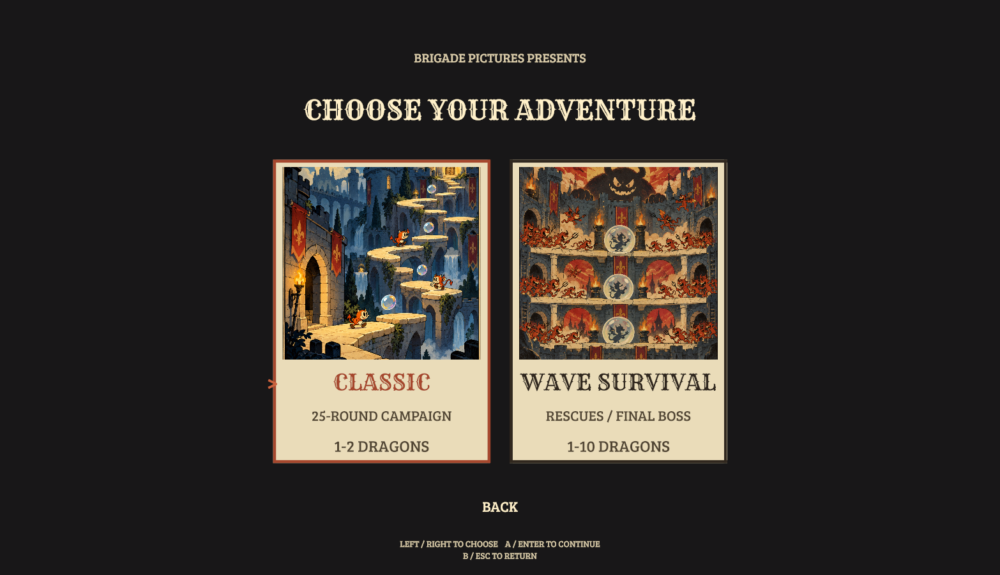
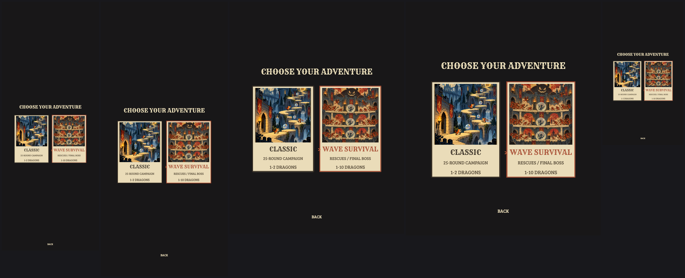
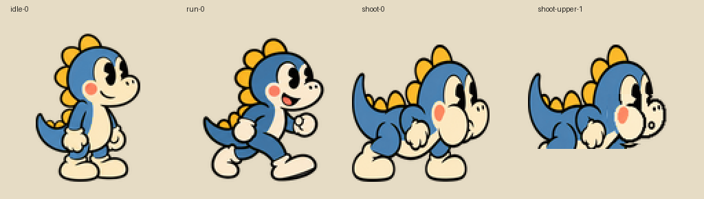
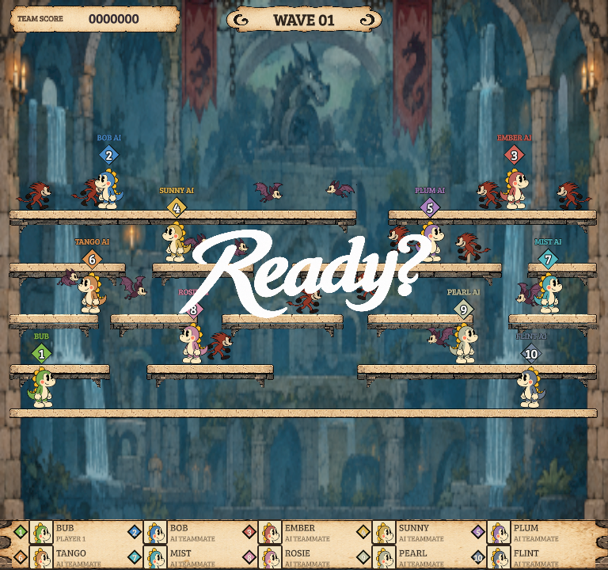
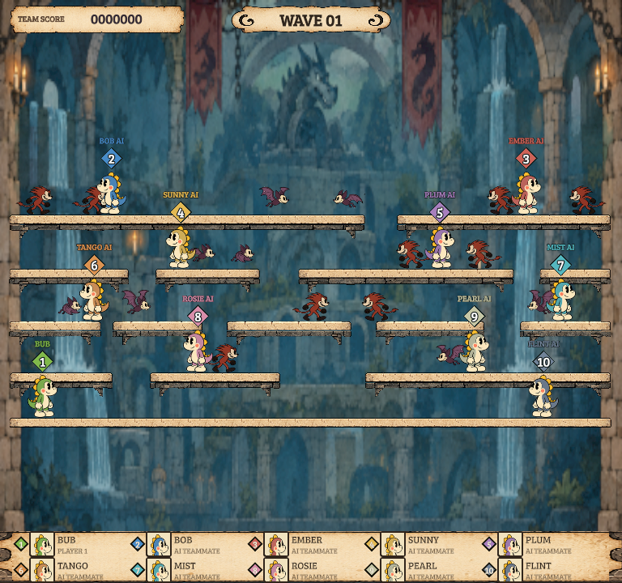
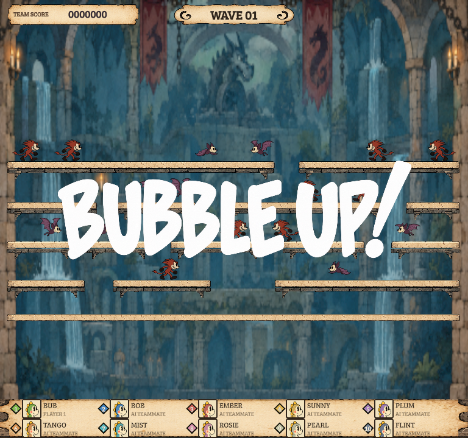
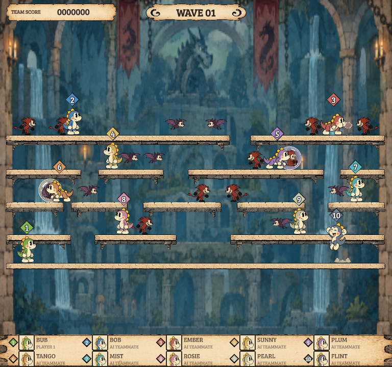

# Feedback pass — 23 October 2026

Addresses the reported rushed/stacked intro, fast iris, mode portraits and blue head oval. This feedback pass follows the original UI checkpoint `b59e044` and is included in the full UI branch merge.

## What changed

- First entry: iris close600ms, billing hold1400ms, reveal800ms. Retry/exit: close450ms, opaque hold5ticks (~83ms), reveal650ms. One shared deterministic timing helper supplies both controller and simulation. Estimates are tuned from feedback, not measured Cuphead timings.
- New-run simulation is frozen during the cover/reveal. Classic then has a separate90tick (1500ms) Ready lead-in before its unchanged60tick preparation. Survival uses its existing180tick preparation after the reveal. Neither preparation clock is consumed by the cover.
- Ready and BUBBLE UP use separate immutable images with mutually exclusive visibility, no displaced copies and no texture crossfade. There is a100ms clear gap. BUBBLE UP has100ms entrance,600ms full hold and300ms exit; it clears at the actual gameplay boundary. [Detailed timing specification](../TIMING-REVISION-3.md).
- Choose Your Adventure now uses two original illustrated cards: a castle campaign route and a wave/rescue/boss arena. Existing names, descriptions, player counts and navigation remain. Red selection changes the card frame and text. Original image bytes are project assets with512-max imports in one atlas. [Art provenance](mode-art-provenance.json).
- Removed the blue head oval from the native sprite generators. The scoped rebuild changes30blue frames and2blue portrait derivatives; all non-blue artwork and original source sheets are unchanged. Logical canvases, muzzle, waist and feet remain registered. [Pixel-scope evidence](../implementation/blue-oval-fix.json).

The mode view's full-bleed root produces existing safe-parent escape warnings in isolated device previews (decorative background extends beyond the safe parent); the interactive cards and Back stay bounded in recorded-input engine tests. No OS/browser automation or standalone playtest was used. Timing, mode navigation, cue visibility and cooked smoke verification use Game Engine only. Final verification results follow below.

## Verification

- **391/391 V8 T0** logic tests passed ([report](logic-tests.json)). Includes sound-event suppression while the scene is frozen, unchanged preparation counters, input gating and existing animation/muzzle regression coverage.
- **18/18 focused T0/T1** passed with phone-low residency ([report](focused-tests.json)). Five intro checks include native-tick Classic/Survival timing and pixel-verified blank/one-word frames.
- Mode-card touch navigation across360×880,768×1024 and1680×720 passes ([report](mode-navigation.json)); both illustrated choices and Back remain pressable. Card rendering is bounded by the existing14draw budget. Reviewed additional fold-cover, notchedphone, tablet, fold-inner and shortphone images.
- **2/2 iris** probes passed ([report](iris-tests.json)); updated only the affected new iris/title golden for the blue-art correction.
- The newly recorded **719-step actual UI journey** verifies without a divergent hash ([report](replay-check.json)). It reaches billing, post-reveal Ready, gameplay, defeat, retry, pause, options and resume.
- `gameengine check` passed typecheck, UI-document coverage, validation, cook and600-frame cooked smoke ([report](engine-check.json)). Existing texture/camera warnings and unmatched3D pipeline program7946469ed20397e0 remain; that known warning still blocks a release build.
- Dual-host run was attempted again; Hermes remains unavailable because its installed host binary is missing ([report](dual-host.json)). Real-phone GPU, peak memory and thermal behavior remain unmeasured. The prior broad T1 baseline differences were not hidden or blanket refreshed.

The intro's measured structural peak remains14draws against14allowed. The two512-max mode illustrations add roughly1.6MiB of uncompressed texture area before atlas overhead; this is an estimate, not device memory evidence. No new shader, camera, gameplay rule or screen type was introduced.

Actual rendered Survival cue states, in sequence:

