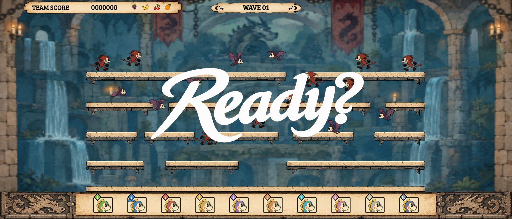
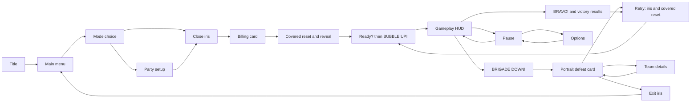
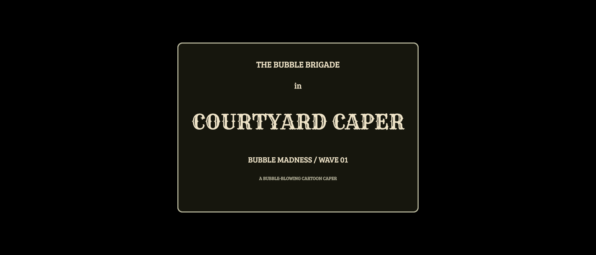
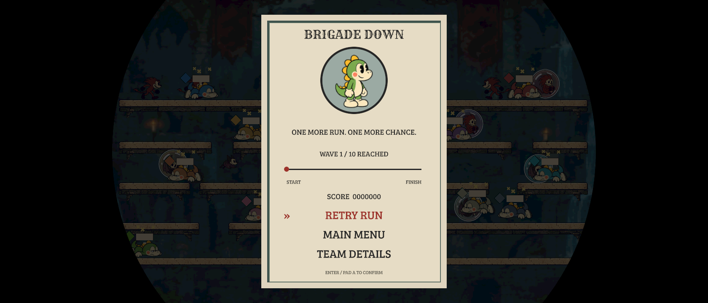
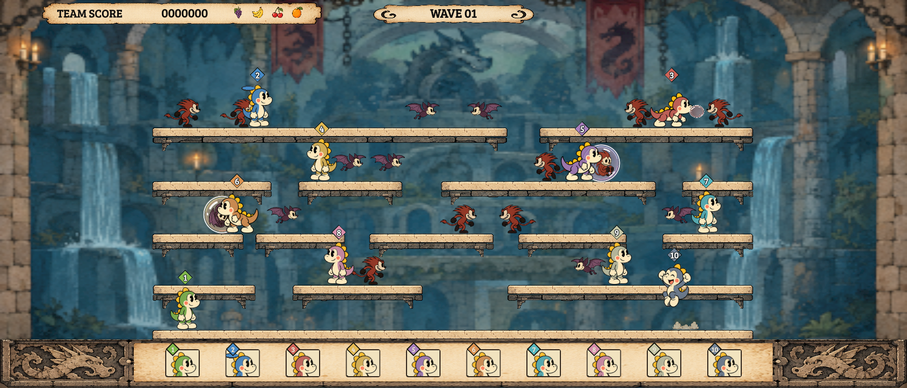
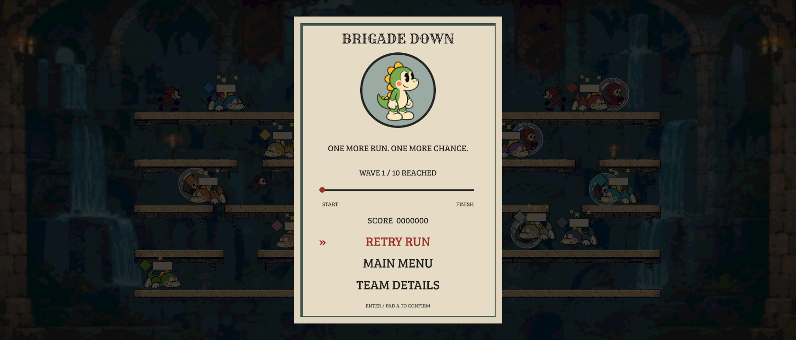

# Cuphead presentation pass — implementation handoff

Implemented 22 October 2026 after approval of [visual revision 2](../VISUAL-REVISION-2.md). This document describes the delivered prototype and its limits. The [original proposal](../PROPOSAL.md) retains the inventory, reference catalog, comparison contact sheets, source paths and proposed later work.

## The main visual correction

The former cream-backed countdown/GO treatment has been replaced by large white brush lettering directly over the arena. Ready? holds as the primary focal point; BUBBLE UP! replaces it before combat. There is no duplicate central GO tile or prepare banner. Our castle, dragons, enemy silhouettes, score, wave information and ten-player roster remain visible.

This is an engine render, not the approved concept image. Original generated lettering is in `assets/cartoon/ui/cues/{ready,bubble-up,brigade-down,bravo}.png`, with importer sidecars and one shared atlas. [Provenance](cue-art-provenance.json) records generation. No extracted Cuphead pixels were copied into production. The pose echoes are short displaced copies with stepped opacity, not individually redrawn frame-by-frame morphs.

## Delivered screens and behavior

| Surface | Implemented change | Reference and adaptation |
|---|---|---|
| Title / main menu | Full-bleed cream composition, our illustrated logo/cast, real touchable start prompt, centered text actions, red text and drawn pointer for focus. | Cuphead title/menu hierarchy; our own typography, logo, characters and labels. No perpetual decorative animation. |
| Mode choice | Dark field, two framed theatrical choices and a safe Back action. Hover uses the recorded screen dimensions, matching the drawn layout on wide and narrow screens. | Stage/menu framing; existing Classic and Bubble Madness mechanics preserved. |
| First entry | Close iris, charcoal billing card, covered run reset, reveal onto the arena. | Cuphead title-card and iris collections. Brigade / in / Courtyard Caper is our text. |
| Ready / action / combat | Oversized white Ready? and BUBBLE UP! over gameplay, short echo poses, explicit opacity drawings, complete removal at the existing combat boundary. | Fight-text collection. Existing preparation, practice fire, movement hold and grace periods are retained. |
| Defeat | BRIGADE DOWN! over the arena, then tall portrait card, brief line, honest completed-stage progress, score, Retry Run / Main Menu / Team Details. | Death-card composition. Progress counts completed rounds/waves; it does not imply nonexistent boss health. Ten team entries remain available in Details. |
| Victory | BRAVO! cue, then blue radial theatrical results preserving scores, team ranking, podium and actions. | Win-screen framing; original geometry, existing result information. |
| Pause / options | Ruled cream pause card over the frozen arena, red focus, confirmation for restarting/ending, caller-aware options. Options presents values in separate aligned rows. | Cuphead pause/menu hierarchy. Extra party setup action and our existing settings are retained. |
| Retry / exit | Circular cover; reset/navigation happens after full cover; reveal. Retry returns to round/wave 1 and omits the billing card. Result Back closes Details first, then leaves through the same cover. | Iris and death/retry presentation, adapted to the existing full-run retry rule. |

The principal local references are under `/Users/eduardoleale/workspace/art/cuphead/`: `collections/102767-fight-text.md`, `98810-loading-hourglass.md`, the title-card, death-card, menu, iris-transition and win-screen collections indexed by [the library](/Users/eduardoleale/workspace/art/cuphead/INDEX.md). Use the original proposal's R1–R13 catalog for exact extracted file paths and visual evidence. Sprite files establish appearance and numbered poses only. The original research could not inspect reliable shipped-version footage in playback; **the implementation does not claim measured Cuphead timing, navigation rules or frame-perfect animation**. All new motion values below are starting estimates.

## Navigation and representative flow

L is accepted Start; P is the gameplay reset/preparation start; D is terminal defeat. Simulation is 60 ticks/second. Preparation does not run during billing.

| Clock / frame | Visual state | Input and control return |
|---|---|---|
| L0–18 / 0–300 ms | Circular close, quadratic acceleration. | Launch is latched once. Further navigation, pause and duplicate launch inputs are rejected. |
| L18–72 / 300–1200 ms | Full cover and billing card, 900 ms interval. | Gameplay has not started. Billing is not skippable in this prototype. |
| L72 = P0 | Run reset under cover. | Held Fire/Jump cannot become a launch action; release arms fresh gameplay input. |
| P0–24 / 0–400 ms | Circular reveal, quadratic ease-out. At L96 the cover is removed. | Menu input remains blocked through reveal. Fresh practice fire remains possible during preparation, preserving the mechanic. First-wave movement/jump remain held by the existing simulation rule. |
| P24–31 | Ready? inks in through explicit opacity states. | Preparation rules above. |
| P31–137 | Ready? hold. | Preparation rules above. |
| P137–144 | Ready? fades away. | Preparation rules above. |
| P144–151 | BUBBLE UP! appears with brief displaced echoes. | Preparation rules above. |
| P151–166 | Action lettering holds. | Preparation rules above. |
| P166–180 | Lettering clears. | At P180 combat and first-wave movement/jump return exactly as before. Existing 120-tick start grace remains. Classic compresses these cue proportions into its existing 60-tick ready period. |
| D0–36 / 0–600 ms | BRIGADE DOWN! over the arena. | Gameplay ended; no result action accepted. |
| D36 onward | Portrait card enters; actions have the existing 45-tick neutral gate. | Result actions arm at D45 **and after controls are released**. The card's 160 ms entrance starts at D36. Team Details does not reset the run. |
| Retry R0–18 | Iris closes over the card. | Retry accepted once; menu/gameplay input blocked. |
| R18–23 | Fully opaque hold, 5 ticks. | No reset yet. Five ticks cover the configured maximum five-step catch-up frame. |
| R23 | Reset to round/wave 1 under cover. | Fresh-action latch resets; team configuration retained. Billing omitted. |
| R23–47 | Reveal to preparation, then remove cover. | Same preparation/fresh-input rules as first entry. Movement/jump return at the existing combat boundary, not when the animation finishes. |

Pause freezes the game immediately. Resume closes the sheet over ten deterministic ticks (~167 ms), then unpauses; Fire/Jump must be released before acting. Recorded `ArcadeInput.paused` cannot bypass the cover or unfreeze pause/options while the sheet exits. Restart/End Run default to Keep Playing in the confirmation card. Score recording and full-run retry semantics remain with the existing state layer.

## Architecture, fit and performance

New screens are UI documents placed by thin MVC views. Documents were changed through `gameengine ui doc`; generated bindings were regenerated. The recorded desktop state owns transition intent, commit and finish ticks. Views do not advance gameplay or own reset callbacks. The iris uses a native rounded border in a document code area, with a special solid rectangle at zero aperture. Its radius is derived from the viewport diagonal so ultrawide corners clear; it is not a stretched cutout sprite.

Checks cover 360×880 phones, 768×1024 tablets, 1680×720 wide windows and additional notched/portrait shapes. Tall-phone menu, defeat and pause actions assert at least 43 logical pixels in height. Safe-screen documents protect interactive content; full-bleed decorative backgrounds extend beyond it. Party Details retains all ten rows. Reduced Effects substitutes opacity cover for the spatial iris, removes cue echoes and preserves the same game/input clocks. It is wired to the existing reduced-motion setting.

The seven recorded structural scenarios pass at peaks of 12–14 draws against a 14-draw limit. The new journey peaks at **14/14**, so another effect requires renewed budgeting. Defeat uses 8 draws, victory 4, options 5–6; the iris adds at most 2 in the viewport probes. Four 1024-max RGBA cue images are approximately 5.6 MB before atlas/trim savings; this is an estimate, not a measured resident peak. Cartoon nonplay screens cap presentation at 30 fps and avoid per-frame model updates when settled. Iris measurement callbacks are removed when their view unmounts.

These are release-host desktop Metal measurements on an Apple M2 Max with phone-low residency constraints. Real phone GPU time, peak resident memory, sustained thermals and idle-frame skipping were not measured. No claim of device performance follows from the draw-call count alone.

## Verification and remaining limits

| Evidence | Result |
|---|---|
| [Final logic run](t0-regressions-final.json) | **388/388 V8 T0 passed.** |
| [Final focused run](final-focused.json) | **14/14 V8 T0/T1 passed**, phone-low. Includes actual UI presses through Start→billing→Ready→combat→defeat→Retry→pause→options→resume, fresh-input gates, result Back, phone targets and hover geometry. New flow replay/goldens recorded. |
| [Native iris probes](iris-final.json) | **2/2 passed**, closed/partial/open and reduced-effects states across aspect ratios. Only this new flow's intentional goldens were refreshed. |
| [Pipeline recording and broad T1](pipeline-record.json) | All **7 structural budgets passed** and all three GPU tiers recorded. Render tests were **56/90**, with **34 failures** involving changed screenshots or exact-color assertions. Some are deliberate changed UI; others remain unclassified. Older baselines were not wholesale replaced, and not all failures are claimed pre-existing. |
| [Final cooked check](engine-check-final.json) | Typecheck, validation, UI-document coverage, desktop cook and **600-frame cooked smoke passed**. Existing scene/texture warnings remain. A pipeline warning also remains: the recorder emits 3D program `7946469ed20397e0`, which validation cannot match to a compiled project material. A release build is blocked by that warning until the engine recording/validation mismatch is resolved. |
| [Dual-host attempt](dual-host.json) | Hermes unavailable: its installed host binary is missing. V8 is verified; dual-engine parity is not. |
| [Replay verification](replay-final.json) | See final recorded journey hash verification. |

No standalone app playtest, OS input, browser automation, user focus control, production deployment, commit or PR was performed. Migration archives and unrelated pre-existing workspace work were preserved.

The first-entry billing and retry are resident-content transitions; no artificial loading percentage or hourglass was added. A genuine asynchronous loading cover/error/retry flow, custom announcer/audio synchronization, drawn per-frame text morphs, exact shipped-Cuphead timing and broader reskinning remain later work from the proposal. Existing touch gameplay controls/mechanics were preserved; this pass improves UI targets, not a new touch-control scheme. Classifying the broad T1 differences, resolving the pipeline validation mismatch, and testing a real phone are required before calling this release-ready.
